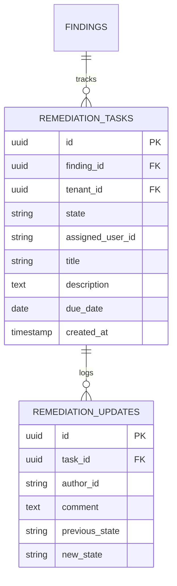

# P3-36 — Define the Remediation Tracking Domain and Data Model

**Parent Epic:** [Phase 3 — Findings Intelligence, Evidence & Reporting](../MILESTONE_PHASE_3.md)  
**Milestone:** [Phase 3 — Findings Intelligence, Evidence & Reporting](../MILESTONE_PHASE_3.md)  
**Workstream:** Workstream E — Assessment History & Remediation  
**Status:** `ready-for-dev`  

---

## 🎯 Purpose

Create the core data model for tracking actions intended to resolve a finding.

---

## 📐 Architecture & Workflow Diagram

---

## 📋 Detailed Requirements

- Define remediation records separately from finding records.
- Support multiple remediation actions for one finding where necessary.
- Define remediation fields: Remediation identifier, Associated finding, Description, Recommended action, Current state, Assigned owner reference, Created and updated timestamps, Target completion date.
- Preserve finding identity when remediation records change.
- Define relationship between remediation and verification assessments.
- Avoid implementing full enterprise ticketing functionality.
- Document database and application boundaries.

---

## 🛡️ Security & Architectural Invariants

- **Tenant Isolation:** All finding, observation, evidence, remediation, and report records must enforce strict tenant boundaries (`tenant_id = current_tenant_id()`, ADR-0002).
- **Data Integrity & Traceability:** Individual assessment observations and evidence records must remain immutable and never be overwritten by subsequent assessments.
- **Evidence Protection:** All sensitive credentials, tokens, session cookies, and authorization headers must be redacted before presentation and export (ADR-0005).
- **Explainability:** All calculated risk scores and priority rankings must be reproducible and mathematically explainable from documented input factors.

---

## ✅ Acceptance Criteria

- [ ] Remediation domain model is documented.
- [ ] Remediation records are linked to findings.
- [ ] Multiple actions can be represented where required.
- [ ] Lifecycle and ownership semantics are defined.
- [ ] Migrations and domain tests are available.

---

## 🔗 Related Documentation & Links

- Findings Domain Architecture: [`docs/architecture/FINDINGS_DOMAIN.md`](../../../docs/architecture/FINDING_SCHEMA.md)
- Evidence Retention & Redaction: [`docs/security/EVIDENCE_LIFECYCLE.md`](../../../docs/security/ACCEPTABLE_USE.md)
- Risk Scoring Specification: [`docs/architecture/RISK_SCORING_MODEL.md`](../../../docs/architecture/SCAN_PROFILES.md)
- System Architecture Baseline: [`docs/architecture/SYSTEM_ARCHITECTURE.md`](../../../docs/architecture/SYSTEM_ARCHITECTURE.md)
