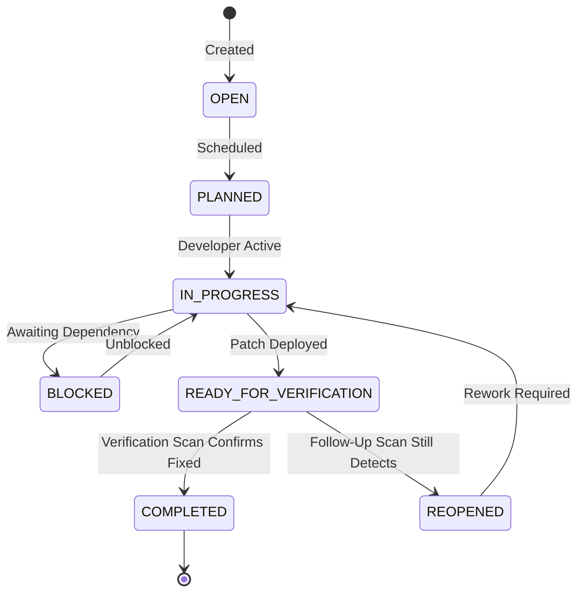

# P3-37 — Implement the Remediation Lifecycle Workflow

**Parent Epic:** [Phase 3 — Findings Intelligence, Evidence & Reporting](../MILESTONE_PHASE_3.md)  
**Milestone:** [Phase 3 — Findings Intelligence, Evidence & Reporting](../MILESTONE_PHASE_3.md)  
**Workstream:** Workstream E — Assessment History & Remediation  
**Status:** `ready-for-dev`  

---

## 🎯 Purpose

Allow users to track remediation progress in a controlled and auditable manner.

---

## 📐 Architecture & Workflow Diagram

---

## 📋 Detailed Requirements

- Define remediation states: Open, Planned, In Progress, Blocked, Ready for Verification, Completed, Reopened.
- Define permitted transitions.
- Require a reason for selected transitions, such as blocking or reopening.
- Keep remediation state distinct from finding lifecycle state.
- Prevent a remediation record marked completed from automatically resolving its finding.
- Record all state transitions.
- Define behavior when the underlying finding is accepted risk or false positive.

---

## 🛡️ Security & Architectural Invariants

- **Tenant Isolation:** All finding, observation, evidence, remediation, and report records must enforce strict tenant boundaries (`tenant_id = current_tenant_id()`, ADR-0002).
- **Data Integrity & Traceability:** Individual assessment observations and evidence records must remain immutable and never be overwritten by subsequent assessments.
- **Evidence Protection:** All sensitive credentials, tokens, session cookies, and authorization headers must be redacted before presentation and export (ADR-0005).
- **Explainability:** All calculated risk scores and priority rankings must be reproducible and mathematically explainable from documented input factors.

---

## ✅ Acceptance Criteria

- [ ] Remediation state machine is implemented.
- [ ] Invalid transitions are rejected.
- [ ] Finding and remediation states remain independent.
- [ ] Transition history is preserved.
- [ ] Tests cover all supported states and transitions.

---

## 🔗 Related Documentation & Links

- Findings Domain Architecture: [`docs/architecture/FINDINGS_DOMAIN.md`](../../../docs/architecture/FINDING_SCHEMA.md)
- Evidence Retention & Redaction: [`docs/security/EVIDENCE_LIFECYCLE.md`](../../../docs/security/ACCEPTABLE_USE.md)
- Risk Scoring Specification: [`docs/architecture/RISK_SCORING_MODEL.md`](../../../docs/architecture/SCAN_PROFILES.md)
- System Architecture Baseline: [`docs/architecture/SYSTEM_ARCHITECTURE.md`](../../../docs/architecture/SYSTEM_ARCHITECTURE.md)
