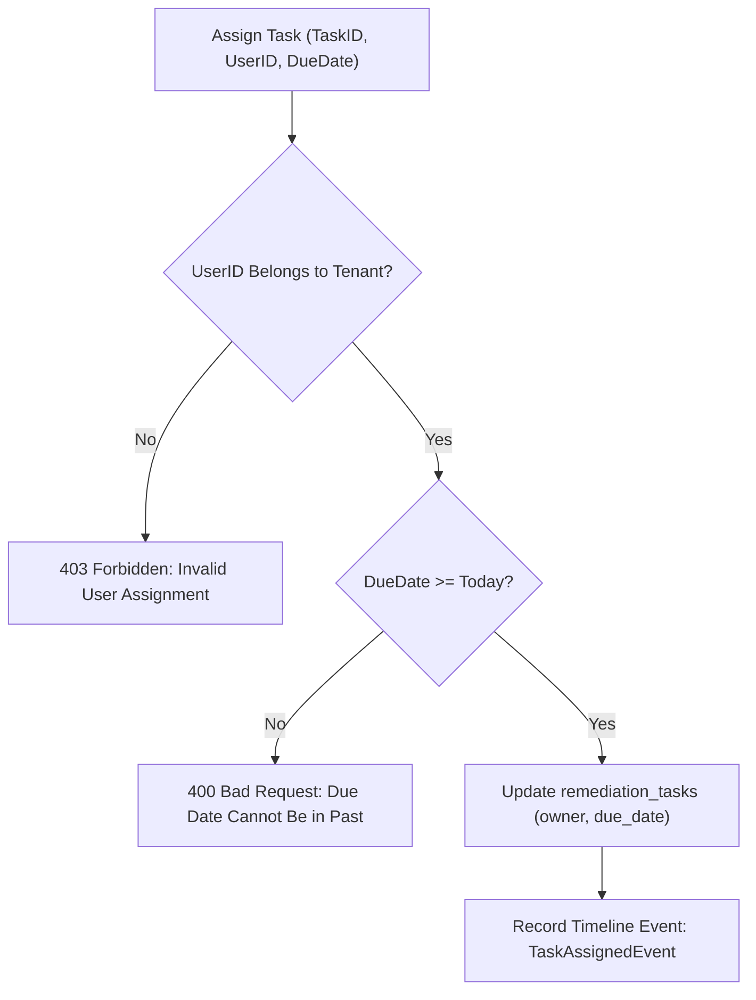

# P3-38 — Implement Remediation Assignment, Ownership and Due Dates

**Parent Epic:** [Phase 3 — Findings Intelligence, Evidence & Reporting](../MILESTONE_PHASE_3.md)  
**Milestone:** [Phase 3 — Findings Intelligence, Evidence & Reporting](../MILESTONE_PHASE_3.md)  
**Workstream:** Workstream E — Assessment History & Remediation  
**Status:** `ready-for-dev`  

---

## 🎯 Purpose

Allow remediation work to be assigned and tracked without requiring the advanced organizational workflow features planned for Phase 4.

---

## 📐 Architecture & Workflow Diagram

---

## 📋 Detailed Requirements

- Support assignment to authorized users within the same tenant.
- Validate the assigned user's eligibility and access.
- Support optional due dates.
- Record assignment and reassignment history.
- Support basic remediation notes and progress updates.
- Prevent unauthorized cross-tenant assignment.
- Define behavior when an assigned user becomes unavailable or loses access.
- Keep advanced team routing, escalation, and notification rules for Phase 4.

---

## 🛡️ Security & Architectural Invariants

- **Tenant Isolation:** All finding, observation, evidence, remediation, and report records must enforce strict tenant boundaries (`tenant_id = current_tenant_id()`, ADR-0002).
- **Data Integrity & Traceability:** Individual assessment observations and evidence records must remain immutable and never be overwritten by subsequent assessments.
- **Evidence Protection:** All sensitive credentials, tokens, session cookies, and authorization headers must be redacted before presentation and export (ADR-0005).
- **Explainability:** All calculated risk scores and priority rankings must be reproducible and mathematically explainable from documented input factors.

---

## ✅ Acceptance Criteria

- [ ] Remediation can be assigned to eligible users.
- [ ] Due dates are validated.
- [ ] Assignment history is recorded.
- [ ] Cross-tenant assignment is prevented.
- [ ] Tests cover reassignment and authorization failures.

---

## 🔗 Related Documentation & Links

- Findings Domain Architecture: [`docs/architecture/FINDINGS_DOMAIN.md`](../../../docs/architecture/FINDING_SCHEMA.md)
- Evidence Retention & Redaction: [`docs/security/EVIDENCE_LIFECYCLE.md`](../../../docs/security/ACCEPTABLE_USE.md)
- Risk Scoring Specification: [`docs/architecture/RISK_SCORING_MODEL.md`](../../../docs/architecture/SCAN_PROFILES.md)
- System Architecture Baseline: [`docs/architecture/SYSTEM_ARCHITECTURE.md`](../../../docs/architecture/SYSTEM_ARCHITECTURE.md)
