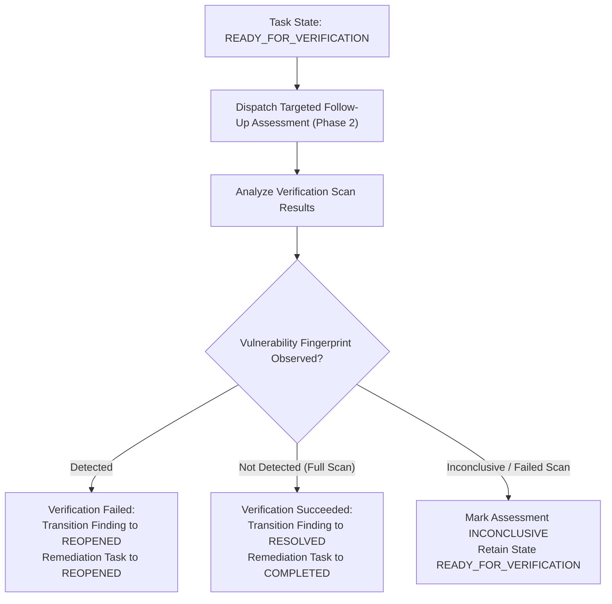

# P3-39 — Implement Remediation Verification Through Follow-Up Assessments

**Parent Epic:** [Phase 3 — Findings Intelligence, Evidence & Reporting](../MILESTONE_PHASE_3.md)  
**Milestone:** [Phase 3 — Findings Intelligence, Evidence & Reporting](../MILESTONE_PHASE_3.md)  
**Workstream:** Workstream E — Assessment History & Remediation  
**Status:** `ready-for-dev`  

---

## 🎯 Purpose

Verify whether remediation has actually addressed a finding by associating it with a later assessment.

---

## 📐 Architecture & Workflow Diagram

---

## 📋 Detailed Requirements

- Allow an authorized user to initiate or associate a follow-up assessment through existing Phase 2 capabilities.
- Ensure the follow-up assessment remains within the authorized target scope.
- Compare new observations with the original finding.
- Define what constitutes sufficient verification evidence.
- Distinguish verified resolution from not detected, inconclusive, and assessment failure.
- Reopen a finding when a matching issue is observed again under approved lifecycle rules.
- Record which assessment was used for verification.
- Never mark a finding resolved solely because a remediation task was marked completed.

---

## 🛡️ Security & Architectural Invariants

- **Tenant Isolation:** All finding, observation, evidence, remediation, and report records must enforce strict tenant boundaries (`tenant_id = current_tenant_id()`, ADR-0002).
- **Data Integrity & Traceability:** Individual assessment observations and evidence records must remain immutable and never be overwritten by subsequent assessments.
- **Evidence Protection:** All sensitive credentials, tokens, session cookies, and authorization headers must be redacted before presentation and export (ADR-0005).
- **Explainability:** All calculated risk scores and priority rankings must be reproducible and mathematically explainable from documented input factors.

---

## ✅ Acceptance Criteria

- [ ] A remediation can be associated with a follow-up assessment.
- [ ] Verification outcomes are explicitly represented.
- [ ] Inconclusive or failed assessments do not imply resolution.
- [ ] Reopened findings preserve their history.
- [ ] Integration tests cover successful and unsuccessful remediation verification.

---

## 🔗 Related Documentation & Links

- Findings Domain Architecture: [`docs/architecture/FINDINGS_DOMAIN.md`](../../../docs/architecture/FINDING_SCHEMA.md)
- Evidence Retention & Redaction: [`docs/security/EVIDENCE_LIFECYCLE.md`](../../../docs/security/ACCEPTABLE_USE.md)
- Risk Scoring Specification: [`docs/architecture/RISK_SCORING_MODEL.md`](../../../docs/architecture/SCAN_PROFILES.md)
- System Architecture Baseline: [`docs/architecture/SYSTEM_ARCHITECTURE.md`](../../../docs/architecture/SYSTEM_ARCHITECTURE.md)
