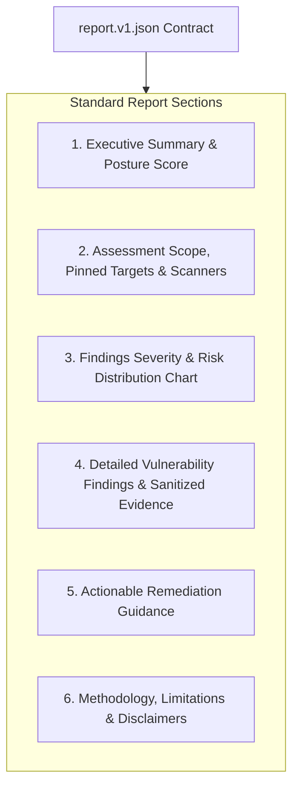

# P3-40 — Define Assessment Report Structure and Template Contracts

**Parent Epic:** [Phase 3 — Findings Intelligence, Evidence & Reporting](../MILESTONE_PHASE_3.md)  
**Milestone:** [Phase 3 — Findings Intelligence, Evidence & Reporting](../MILESTONE_PHASE_3.md)  
**Workstream:** Workstream F — Reporting, Search & User Experience  
**Status:** `ready-for-dev`  

---

## 🎯 Purpose

Define the structure and content requirements for KELVIN's first customer-facing assessment reports.

---

## 📐 Architecture & Workflow Diagram

---

## 📋 Detailed Requirements

- Define a versioned report data contract (report.v1.json).
- Define report sections: Assessment summary, Target and authorized scope, Assessment profile and scanner information, Execution status and limitations, Findings summary, Severity and priority distribution, Individual finding details, Evidence references and sanitized evidence, Remediation recommendations, Assessment timestamps and provenance.
- Distinguish actual assessment results from generated explanatory text.
- Define how partial assessments are disclosed.
- Define which sensitive fields must be excluded or redacted.
- Support a versioned report template.
- Document report limitations and intended audience.

---

## 🛡️ Security & Architectural Invariants

- **Tenant Isolation:** All finding, observation, evidence, remediation, and report records must enforce strict tenant boundaries (`tenant_id = current_tenant_id()`, ADR-0002).
- **Data Integrity & Traceability:** Individual assessment observations and evidence records must remain immutable and never be overwritten by subsequent assessments.
- **Evidence Protection:** All sensitive credentials, tokens, session cookies, and authorization headers must be redacted before presentation and export (ADR-0005).
- **Explainability:** All calculated risk scores and priority rankings must be reproducible and mathematically explainable from documented input factors.

---

## ✅ Acceptance Criteria

- [ ] A report content specification exists.
- [ ] Report data fields are traceable to stored records.
- [ ] Partial assessment limitations are disclosed.
- [ ] Redaction requirements are documented.
- [ ] Templates are versioned.

---

## 🔗 Related Documentation & Links

- Findings Domain Architecture: [`docs/architecture/FINDINGS_DOMAIN.md`](../../../docs/architecture/FINDING_SCHEMA.md)
- Evidence Retention & Redaction: [`docs/security/EVIDENCE_LIFECYCLE.md`](../../../docs/security/ACCEPTABLE_USE.md)
- Risk Scoring Specification: [`docs/architecture/RISK_SCORING_MODEL.md`](../../../docs/architecture/SCAN_PROFILES.md)
- System Architecture Baseline: [`docs/architecture/SYSTEM_ARCHITECTURE.md`](../../../docs/architecture/SYSTEM_ARCHITECTURE.md)
