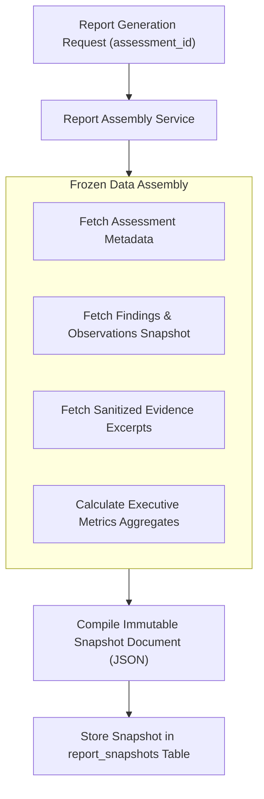

# P3-41 — Implement Report Snapshot and Data Assembly Service

**Parent Epic:** [Phase 3 — Findings Intelligence, Evidence & Reporting](../MILESTONE_PHASE_3.md)  
**Milestone:** [Phase 3 — Findings Intelligence, Evidence & Reporting](../MILESTONE_PHASE_3.md)  
**Workstream:** Workstream F — Reporting, Search & User Experience  
**Status:** `ready-for-dev`  

---

## 🎯 Purpose

Assemble a consistent point-in-time view of assessment and finding data before generating a report.

---

## 📐 Architecture & Workflow Diagram

---

## 📋 Detailed Requirements

- Implement a report assembly service.
- Retrieve assessment, finding, observation, risk, remediation, and evidence metadata.
- Apply tenant authorization before assembling report data.
- Use a consistent snapshot or equivalent strategy to avoid mixing incompatible versions of changing records.
- Record the report's source assessment and included data references.
- Handle findings that change while a report is being generated.
- Ensure evidence is redacted before inclusion.
- Distinguish unavailable data from empty data.
- Version the assembled report data.

---

## 🛡️ Security & Architectural Invariants

- **Tenant Isolation:** All finding, observation, evidence, remediation, and report records must enforce strict tenant boundaries (`tenant_id = current_tenant_id()`, ADR-0002).
- **Data Integrity & Traceability:** Individual assessment observations and evidence records must remain immutable and never be overwritten by subsequent assessments.
- **Evidence Protection:** All sensitive credentials, tokens, session cookies, and authorization headers must be redacted before presentation and export (ADR-0005).
- **Explainability:** All calculated risk scores and priority rankings must be reproducible and mathematically explainable from documented input factors.

---

## ✅ Acceptance Criteria

- [ ] Report data is assembled through a dedicated service.
- [ ] Source records and versions are traceable.
- [ ] Authorization is enforced.
- [ ] Snapshot consistency is defined and tested.
- [ ] Missing or partial data is represented accurately.

---

## 🔗 Related Documentation & Links

- Findings Domain Architecture: [`docs/architecture/FINDINGS_DOMAIN.md`](../../../docs/architecture/FINDING_SCHEMA.md)
- Evidence Retention & Redaction: [`docs/security/EVIDENCE_LIFECYCLE.md`](../../../docs/security/ACCEPTABLE_USE.md)
- Risk Scoring Specification: [`docs/architecture/RISK_SCORING_MODEL.md`](../../../docs/architecture/SCAN_PROFILES.md)
- System Architecture Baseline: [`docs/architecture/SYSTEM_ARCHITECTURE.md`](../../../docs/architecture/SYSTEM_ARCHITECTURE.md)
