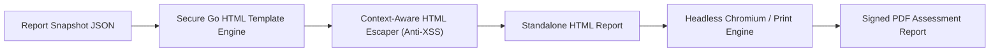

# P3-42 — Implement HTML and PDF Assessment Report Generation

**Parent Epic:** [Phase 3 — Findings Intelligence, Evidence & Reporting](../MILESTONE_PHASE_3.md)  
**Milestone:** [Phase 3 — Findings Intelligence, Evidence & Reporting](../MILESTONE_PHASE_3.md)  
**Workstream:** Workstream F — Reporting, Search & User Experience  
**Status:** `ready-for-dev`  

---

## 🎯 Purpose

Generate readable assessment reports from the approved report data contract.

---

## 📐 Architecture & Workflow Diagram

---

## 📋 Detailed Requirements

- Implement a report rendering service.
- Support HTML output for structured presentation.
- Support PDF output for downloadable reports.
- Use versioned templates.
- Include assessment metadata and execution limitations.
- Include findings with severity, risk context, affected locations, and remediation guidance.
- Include only authorized and appropriately redacted evidence.
- Handle long reports and large finding collections safely.
- Prevent untrusted finding content from injecting scripts or markup into rendered reports (XSS protection).
- Define rendering time and resource limits.
- Ensure the report can be regenerated from its recorded source snapshot and template version where data retention permits.

---

## 🛡️ Security & Architectural Invariants

- **Tenant Isolation:** All finding, observation, evidence, remediation, and report records must enforce strict tenant boundaries (`tenant_id = current_tenant_id()`, ADR-0002).
- **Data Integrity & Traceability:** Individual assessment observations and evidence records must remain immutable and never be overwritten by subsequent assessments.
- **Evidence Protection:** All sensitive credentials, tokens, session cookies, and authorization headers must be redacted before presentation and export (ADR-0005).
- **Explainability:** All calculated risk scores and priority rankings must be reproducible and mathematically explainable from documented input factors.

---

## ✅ Acceptance Criteria

- [ ] HTML and PDF reports can be generated.
- [ ] Generated reports use versioned templates.
- [ ] Untrusted content is safely escaped or sanitized.
- [ ] Sensitive evidence is redacted.
- [ ] Large reports are handled within defined limits.
- [ ] Rendering tests cover representative assessment sizes and content.

---

## 🔗 Related Documentation & Links

- Findings Domain Architecture: [`docs/architecture/FINDINGS_DOMAIN.md`](../../../docs/architecture/FINDING_SCHEMA.md)
- Evidence Retention & Redaction: [`docs/security/EVIDENCE_LIFECYCLE.md`](../../../docs/security/ACCEPTABLE_USE.md)
- Risk Scoring Specification: [`docs/architecture/RISK_SCORING_MODEL.md`](../../../docs/architecture/SCAN_PROFILES.md)
- System Architecture Baseline: [`docs/architecture/SYSTEM_ARCHITECTURE.md`](../../../docs/architecture/SYSTEM_ARCHITECTURE.md)
