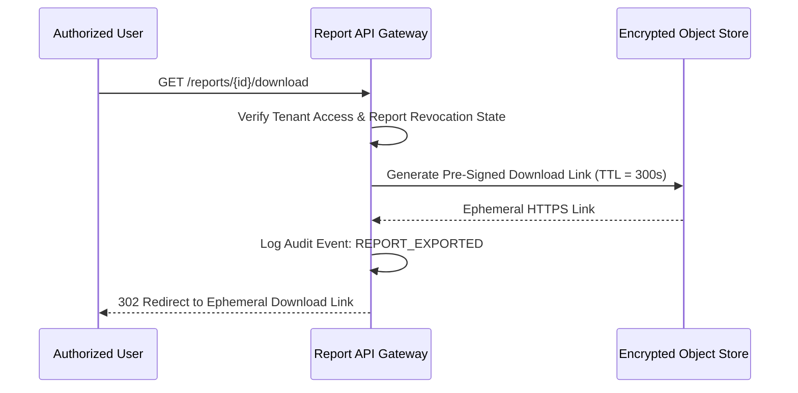

# P3-43 — Implement Secure Report Storage, Export and Download

**Parent Epic:** [Phase 3 — Findings Intelligence, Evidence & Reporting](../MILESTONE_PHASE_3.md)  
**Milestone:** [Phase 3 — Findings Intelligence, Evidence & Reporting](../MILESTONE_PHASE_3.md)  
**Workstream:** Workstream F — Reporting, Search & User Experience  
**Status:** `ready-for-dev`  

---

## 🎯 Purpose

Make generated reports available to authorized users without exposing report files through public or predictable locations.

---

## 📐 Architecture & Workflow Diagram

---

## 📋 Detailed Requirements

- Define where generated report artifacts are stored.
- Associate each report with its tenant, source assessment, template version, and creation time.
- Enforce authorization for listing and downloading reports.
- Use non-guessable report identifiers.
- Use short-lived access mechanisms where direct object delivery is needed.
- Record download and export activity where required.
- Prevent access after an applicable retention or revocation event.
- Define behavior when report generation or storage fails.
- Avoid exposing storage credentials and internal paths.
- Support regeneration when permitted by the report lifecycle policy.

---

## 🛡️ Security & Architectural Invariants

- **Tenant Isolation:** All finding, observation, evidence, remediation, and report records must enforce strict tenant boundaries (`tenant_id = current_tenant_id()`, ADR-0002).
- **Data Integrity & Traceability:** Individual assessment observations and evidence records must remain immutable and never be overwritten by subsequent assessments.
- **Evidence Protection:** All sensitive credentials, tokens, session cookies, and authorization headers must be redacted before presentation and export (ADR-0005).
- **Explainability:** All calculated risk scores and priority rankings must be reproducible and mathematically explainable from documented input factors.

---

## ✅ Acceptance Criteria

- [ ] Reports are stored through a controlled service.
- [ ] Unauthorized users cannot retrieve report artifacts.
- [ ] Download access is traceable.
- [ ] Expired or revoked reports are unavailable.
- [ ] Storage failure and regeneration behavior are tested.

---

## 🔗 Related Documentation & Links

- Findings Domain Architecture: [`docs/architecture/FINDINGS_DOMAIN.md`](../../../docs/architecture/FINDING_SCHEMA.md)
- Evidence Retention & Redaction: [`docs/security/EVIDENCE_LIFECYCLE.md`](../../../docs/security/ACCEPTABLE_USE.md)
- Risk Scoring Specification: [`docs/architecture/RISK_SCORING_MODEL.md`](../../../docs/architecture/SCAN_PROFILES.md)
- System Architecture Baseline: [`docs/architecture/SYSTEM_ARCHITECTURE.md`](../../../docs/architecture/SYSTEM_ARCHITECTURE.md)
