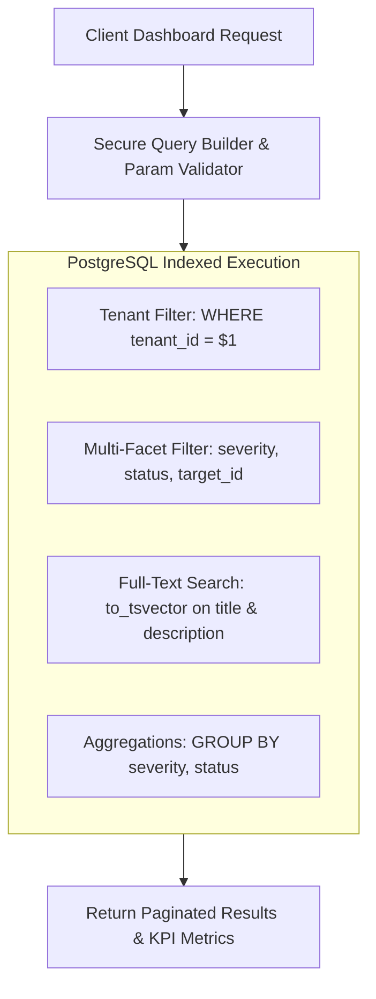

# P3-44 — Implement Findings Search, Filtering and Dashboard APIs

**Parent Epic:** [Phase 3 — Findings Intelligence, Evidence & Reporting](../MILESTONE_PHASE_3.md)  
**Milestone:** [Phase 3 — Findings Intelligence, Evidence & Reporting](../MILESTONE_PHASE_3.md)  
**Workstream:** Workstream F — Reporting, Search & User Experience  
**Status:** `ready-for-dev`  

---

## 🎯 Purpose

Provide the backend query capabilities required for users to understand and navigate their assessment results.

---

## 📐 Architecture & Workflow Diagram

---

## 📋 Detailed Requirements

- Implement tenant-scoped findings listing (GET /api/v1/findings).
- Support pagination and stable sorting.
- Support filtering by: Severity, Risk priority, Finding status, Scanner, Target, Assessment, First observed and last observed date ranges, Remediation status, Suppression state.
- Support text search over approved finding fields (Title, Description, Path).
- Define query limits and validation to prevent expensive unbounded database operations.
- Implement summary aggregations for: Total findings, Findings by severity, Findings by lifecycle state, Open and resolved findings, Findings by assessment, Remediation progress.
- Ensure dashboard totals follow the same tenant and authorization rules as finding retrieval.
- Document endpoints in OpenAPI.

---

## 🛡️ Security & Architectural Invariants

- **Tenant Isolation:** All finding, observation, evidence, remediation, and report records must enforce strict tenant boundaries (`tenant_id = current_tenant_id()`, ADR-0002).
- **Data Integrity & Traceability:** Individual assessment observations and evidence records must remain immutable and never be overwritten by subsequent assessments.
- **Evidence Protection:** All sensitive credentials, tokens, session cookies, and authorization headers must be redacted before presentation and export (ADR-0005).
- **Explainability:** All calculated risk scores and priority rankings must be reproducible and mathematically explainable from documented input factors.

---

## ✅ Acceptance Criteria

- [ ] Findings can be searched and filtered through documented APIs.
- [ ] Pagination and sorting are stable.
- [ ] Tenant access rules apply to all queries and aggregations.
- [ ] Query limits prevent unbounded requests.
- [ ] Summary values are consistent with the underlying authorized data.
- [ ] API tests cover filtering, sorting, pagination, and isolation.

---

## 🔗 Related Documentation & Links

- Findings Domain Architecture: [`docs/architecture/FINDINGS_DOMAIN.md`](../../../docs/architecture/FINDING_SCHEMA.md)
- Evidence Retention & Redaction: [`docs/security/EVIDENCE_LIFECYCLE.md`](../../../docs/security/ACCEPTABLE_USE.md)
- Risk Scoring Specification: [`docs/architecture/RISK_SCORING_MODEL.md`](../../../docs/architecture/SCAN_PROFILES.md)
- System Architecture Baseline: [`docs/architecture/SYSTEM_ARCHITECTURE.md`](../../../docs/architecture/SYSTEM_ARCHITECTURE.md)
