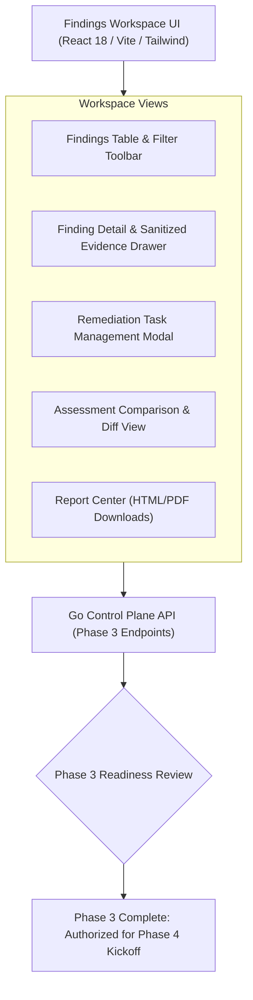

# P3-45 — Build the Findings Workspace UI and Complete Phase 3 Readiness Review

**Parent Epic:** [Phase 3 — Findings Intelligence, Evidence & Reporting](../MILESTONE_PHASE_3.md)  
**Milestone:** [Phase 3 — Findings Intelligence, Evidence & Reporting](../MILESTONE_PHASE_3.md)  
**Workstream:** Workstream F — Reporting, Search & User Experience  
**Status:** `ready-for-dev`  

---

## 🎯 Purpose

Deliver the first complete KELVIN user experience for reviewing assessment findings, examining evidence, tracking remediation, and accessing reports. Verify the complete Phase 3 pipeline before moving to Phase 4.

---

## 📐 Architecture & Workflow Diagram

---

## 📋 Detailed Requirements

- Build Findings Workspace Overview: display finding counts, severity distributions, multi-facet filtering, and status badges.
- Build Finding Detail Drawer/Page: display description, target, severity, risk score, confidence, scoring explanation, observation timeline, sanitized evidence, and triage controls.
- Build Remediation Tracking View: update progress, display assignee, due dates, and verification scan results.
- Build Assessment Comparison View: side-by-side delta between two assessments.
- Build Report Center: generate, view, and securely download HTML/PDF reports.
- Conduct Full Pipeline Integration Review: verify Phase 2-to-Phase 3 result flow, idempotency, tenant isolation, evidence redaction, and risk score reproducibility.
- Publish Phase 3 Readiness Report.

---

## 🛡️ Security & Architectural Invariants

- **Tenant Isolation:** All finding, observation, evidence, remediation, and report records must enforce strict tenant boundaries (`tenant_id = current_tenant_id()`, ADR-0002).
- **Data Integrity & Traceability:** Individual assessment observations and evidence records must remain immutable and never be overwritten by subsequent assessments.
- **Evidence Protection:** All sensitive credentials, tokens, session cookies, and authorization headers must be redacted before presentation and export (ADR-0005).
- **Explainability:** All calculated risk scores and priority rankings must be reproducible and mathematically explainable from documented input factors.

---

## ✅ Acceptance Criteria

- [ ] Users can view and search assessment findings.
- [ ] Users can inspect finding details, observations, and sanitized evidence.
- [ ] Authorized users can triage findings and track remediation.
- [ ] Assessment history and comparison work as documented.
- [ ] HTML/PDF report generation and secure download work.
- [ ] All Phase 3 API and tenant authorization tests pass.
- [ ] End-to-End tests cover the complete assessment-result-to-findings workflow.
- [ ] No unresolved critical or high-severity Phase 3 security defects remain.
- [ ] Phase 3 readiness report is produced and reviewed.

---

## 🔗 Related Documentation & Links

- Findings Domain Architecture: [`docs/architecture/FINDINGS_DOMAIN.md`](../../../docs/architecture/FINDING_SCHEMA.md)
- Evidence Retention & Redaction: [`docs/security/EVIDENCE_LIFECYCLE.md`](../../../docs/security/ACCEPTABLE_USE.md)
- Risk Scoring Specification: [`docs/architecture/RISK_SCORING_MODEL.md`](../../../docs/architecture/SCAN_PROFILES.md)
- System Architecture Baseline: [`docs/architecture/SYSTEM_ARCHITECTURE.md`](../../../docs/architecture/SYSTEM_ARCHITECTURE.md)
