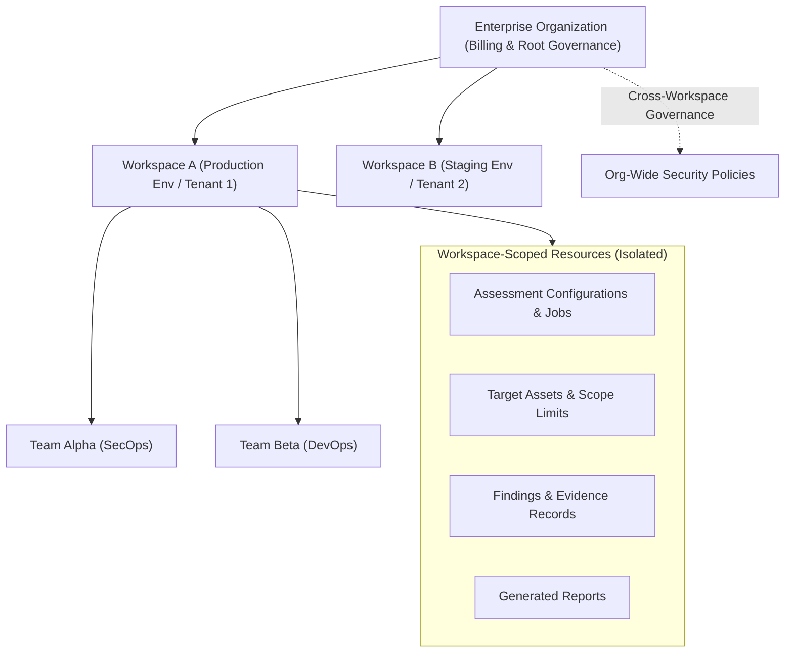

# P4-01 — Define the Enterprise Organization and Workspace Hierarchy

**Parent Epic:** [Phase 4 — Enterprise Platform, Security & Scalability](../MILESTONE_PHASE_4.md)  
**Milestone:** [Phase 4 — Enterprise Platform, Security & Scalability](../MILESTONE_PHASE_4.md)  
**Workstream:** Workstream A — Organization & Team Administration  
**Status:** `ready-for-dev`  

---

## 🎯 Purpose

Define how enterprise organizations, workspaces, tenants, and users relate to one another without weakening the tenant isolation architecture established in Phase 1.

---

## 📐 Architecture & Workflow Diagram

---

## 📋 Detailed Requirements

- Define the distinction between an organization, workspace, tenant, team, and individual user.
- Decide whether an organization owns one workspace or can contain multiple isolated workspaces.
- Define resource ownership for: Assessment configurations, Targets and target references, Assessment records, Findings, Evidence, Reports, Integrations, and API identities.
- Define which resources are organization-wide and which are workspace-specific.
- Establish explicit sharing boundaries.
- Define how organization administrators differ from workspace administrators.
- Document the migration and compatibility implications for existing tenant records.
- Ensure no organization relationship implicitly grants access to resources without an authorization rule.

---

## 🛡️ Security & Architectural Invariants

- **Enterprise Multi-Tenancy:** Multi-organization and workspace hierarchy must never bypass or compromise the core tenant isolation boundaries established in ADR-0002.
- **Principle of Least Privilege:** RBAC/ABAC policy engines and service identity delegation must deny access by default and explicitly enforce permission scopes.
- **Tamper-Evident Auditability:** All administrative actions, SSO events, policy alterations, secret accesses, and integration invocations must emit structured, immutable audit log events.
- **Fail-Safe Operation:** Quotas, rate limits, distributed queue failovers, and webhook dispatchers must degrade gracefully without data loss, deadlocks, or silent failures.

---

## ✅ Acceptance Criteria

- [ ] An approved organization and workspace domain model exists.
- [ ] Ownership boundaries are documented.
- [ ] Existing tenant isolation remains intact.
- [ ] Resource-sharing rules are explicit.
- [ ] Required schema changes and ADRs are approved.

---

## 🔗 Related Documentation & Links

- Enterprise Architecture Baseline: [`docs/architecture/SYSTEM_ARCHITECTURE.md`](../../../docs/architecture/SYSTEM_ARCHITECTURE.md)
- Multi-Tenancy & Isolation Model: [`docs/architecture/TENANT_ISOLATION.md`](../../../docs/architecture/TENANT_ISOLATION.md)
- Security Policies & Auditing: [`docs/security/AUDIT_SPECIFICATION.md`](../../../docs/security/AUDIT_SPECIFICATION.md)
- API & Webhook Specifications: [`docs/api/API_SPECIFICATION.md`](../../../docs/api/API_SPECIFICATION.md)
