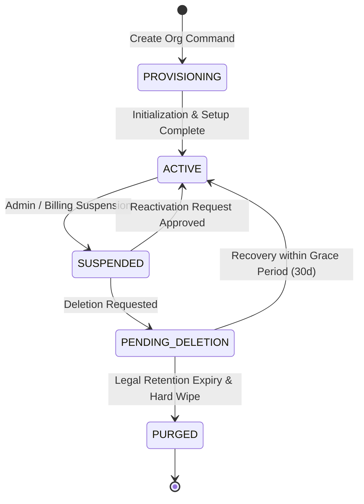

# P4-02 — Implement Organization Lifecycle Management

**Parent Epic:** [Phase 4 — Enterprise Platform, Security & Scalability](../MILESTONE_PHASE_4.md)  
**Milestone:** [Phase 4 — Enterprise Platform, Security & Scalability](../MILESTONE_PHASE_4.md)  
**Workstream:** Workstream A — Organization & Team Administration  
**Status:** `ready-for-dev`  

---

## 🎯 Purpose

Implement the application services required to create, configure, suspend, reactivate, and manage enterprise organizations.

---

## 📐 Architecture & Workflow Diagram

---

## 📋 Detailed Requirements

- Support organization creation and initial configuration.
- Define organization states, including active, suspended, and pending deletion where applicable.
- Implement authorized lifecycle transitions.
- Define the effect of organization suspension on user access, active sessions, new assessments, queued/running jobs, findings, reports, and integrations.
- Ensure suspension does not silently delete assessment history or evidence.
- Define the behavior of existing API keys and service identities.
- Record organization lifecycle changes in the audit system.
- Make lifecycle operations idempotent where appropriate.

---

## 🛡️ Security & Architectural Invariants

- **Enterprise Multi-Tenancy:** Multi-organization and workspace hierarchy must never bypass or compromise the core tenant isolation boundaries established in ADR-0002.
- **Principle of Least Privilege:** RBAC/ABAC policy engines and service identity delegation must deny access by default and explicitly enforce permission scopes.
- **Tamper-Evident Auditability:** All administrative actions, SSO events, policy alterations, secret accesses, and integration invocations must emit structured, immutable audit log events.
- **Fail-Safe Operation:** Quotas, rate limits, distributed queue failovers, and webhook dispatchers must degrade gracefully without data loss, deadlocks, or silent failures.

---

## ✅ Acceptance Criteria

- [ ] Authorized administrators can manage organization lifecycle states.
- [ ] Suspended organizations cannot perform prohibited operations.
- [ ] Existing records remain protected.
- [ ] Active access and execution behavior follows documented suspension rules.
- [ ] Lifecycle changes are auditable and tested.

---

## 🔗 Related Documentation & Links

- Enterprise Architecture Baseline: [`docs/architecture/SYSTEM_ARCHITECTURE.md`](../../../docs/architecture/SYSTEM_ARCHITECTURE.md)
- Multi-Tenancy & Isolation Model: [`docs/architecture/TENANT_ISOLATION.md`](../../../docs/architecture/TENANT_ISOLATION.md)
- Security Policies & Auditing: [`docs/security/AUDIT_SPECIFICATION.md`](../../../docs/security/AUDIT_SPECIFICATION.md)
- API & Webhook Specifications: [`docs/api/API_SPECIFICATION.md`](../../../docs/api/API_SPECIFICATION.md)
