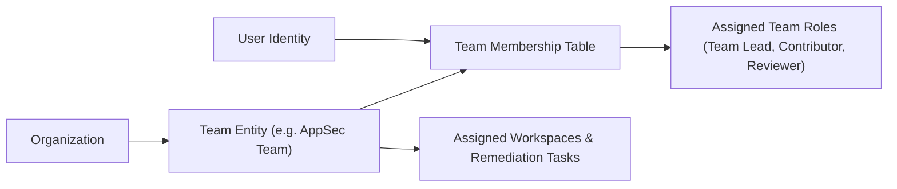

# P4-03 — Implement Team and Group Management

**Parent Epic:** [Phase 4 — Enterprise Platform, Security & Scalability](../MILESTONE_PHASE_4.md)  
**Milestone:** [Phase 4 — Enterprise Platform, Security & Scalability](../MILESTONE_PHASE_4.md)  
**Workstream:** Workstream A — Organization & Team Administration  
**Status:** `ready-for-dev`  

---

## 🎯 Purpose

Allow enterprise organizations to organize users into teams and groups for access control and collaboration.

---

## 📐 Architecture & Workflow Diagram

---

## 📋 Detailed Requirements

- Implement team creation, update, and deletion or archival.
- Associate teams with an organization or workspace according to the approved hierarchy.
- Support team membership management.
- Define team-level roles and permissions.
- Prevent team membership from crossing unauthorized organization boundaries.
- Define behavior for users belonging to multiple teams.
- Support team ownership and administrative responsibility.
- Allow findings and remediation records to reference teams where appropriate.
- Preserve audit history when a team is renamed, archived, or reorganized.

---

## 🛡️ Security & Architectural Invariants

- **Enterprise Multi-Tenancy:** Multi-organization and workspace hierarchy must never bypass or compromise the core tenant isolation boundaries established in ADR-0002.
- **Principle of Least Privilege:** RBAC/ABAC policy engines and service identity delegation must deny access by default and explicitly enforce permission scopes.
- **Tamper-Evident Auditability:** All administrative actions, SSO events, policy alterations, secret accesses, and integration invocations must emit structured, immutable audit log events.
- **Fail-Safe Operation:** Quotas, rate limits, distributed queue failovers, and webhook dispatchers must degrade gracefully without data loss, deadlocks, or silent failures.

---

## ✅ Acceptance Criteria

- [ ] Authorized users can manage teams.
- [ ] Team membership respects organization boundaries.
- [ ] Users can belong to multiple permitted teams.
- [ ] Team references remain consistent when teams are archived.
- [ ] Team operations are covered by authorization and audit tests.

---

## 🔗 Related Documentation & Links

- Enterprise Architecture Baseline: [`docs/architecture/SYSTEM_ARCHITECTURE.md`](../../../docs/architecture/SYSTEM_ARCHITECTURE.md)
- Multi-Tenancy & Isolation Model: [`docs/architecture/TENANT_ISOLATION.md`](../../../docs/architecture/TENANT_ISOLATION.md)
- Security Policies & Auditing: [`docs/security/AUDIT_SPECIFICATION.md`](../../../docs/security/AUDIT_SPECIFICATION.md)
- API & Webhook Specifications: [`docs/api/API_SPECIFICATION.md`](../../../docs/api/API_SPECIFICATION.md)
