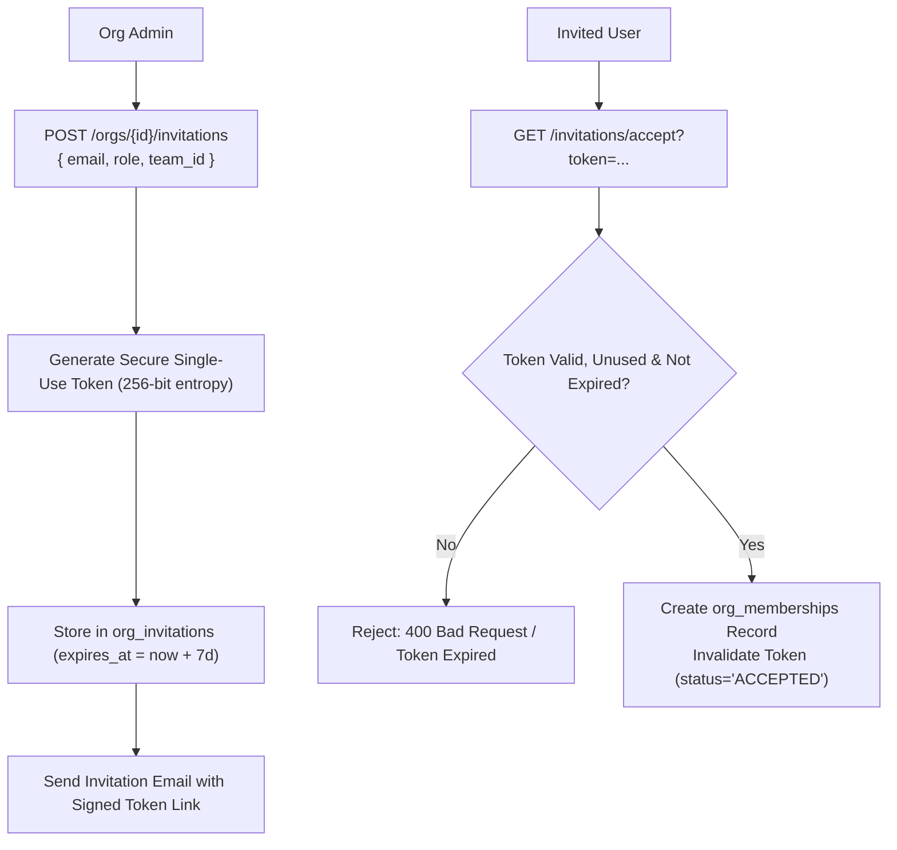

# P4-04 — Implement Organization Membership and Invitation Management

**Parent Epic:** [Phase 4 — Enterprise Platform, Security & Scalability](../MILESTONE_PHASE_4.md)  
**Milestone:** [Phase 4 — Enterprise Platform, Security & Scalability](../MILESTONE_PHASE_4.md)  
**Workstream:** Workstream A — Organization & Team Administration  
**Status:** `ready-for-dev`  

---

## 🎯 Purpose

Provide a secure process for inviting users into an organization and managing their membership.

---

## 📐 Architecture & Workflow Diagram

---

## 📋 Detailed Requirements

- Support invitations through approved email-based workflows.
- Define invitation lifecycle states: pending, accepted, expired, revoked, declined.
- Generate cryptographically secure, single-use invitation tokens.
- Set invitation expiration (e.g. 7 days default).
- Associate invitations with the intended organization and optional team.
- Prevent invitation acceptance from granting permissions beyond the approved role.
- Enforce email and organization verification rules where applicable.
- Prevent unauthorized invitation replay and token reuse.
- Record inviter, invitee, role assignment, and invitation history.
- Support revocation and reissuance.

---

## 🛡️ Security & Architectural Invariants

- **Enterprise Multi-Tenancy:** Multi-organization and workspace hierarchy must never bypass or compromise the core tenant isolation boundaries established in ADR-0002.
- **Principle of Least Privilege:** RBAC/ABAC policy engines and service identity delegation must deny access by default and explicitly enforce permission scopes.
- **Tamper-Evident Auditability:** All administrative actions, SSO events, policy alterations, secret accesses, and integration invocations must emit structured, immutable audit log events.
- **Fail-Safe Operation:** Quotas, rate limits, distributed queue failovers, and webhook dispatchers must degrade gracefully without data loss, deadlocks, or silent failures.

---

## ✅ Acceptance Criteria

- [ ] Authorized administrators can invite users.
- [ ] Invitation tokens are single-use and expire.
- [ ] Invitations cannot be used to join unauthorized organizations.
- [ ] Expired and revoked invitations are rejected.
- [ ] Membership creation is auditable and idempotent.

---

## 🔗 Related Documentation & Links

- Enterprise Architecture Baseline: [`docs/architecture/SYSTEM_ARCHITECTURE.md`](../../../docs/architecture/SYSTEM_ARCHITECTURE.md)
- Multi-Tenancy & Isolation Model: [`docs/architecture/TENANT_ISOLATION.md`](../../../docs/architecture/TENANT_ISOLATION.md)
- Security Policies & Auditing: [`docs/security/AUDIT_SPECIFICATION.md`](../../../docs/security/AUDIT_SPECIFICATION.md)
- API & Webhook Specifications: [`docs/api/API_SPECIFICATION.md`](../../../docs/api/API_SPECIFICATION.md)
