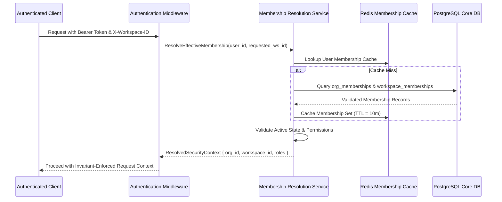

# P4-05 — Implement Organization Membership and Ownership Resolution

**Parent Epic:** [Phase 4 — Enterprise Platform, Security & Scalability](../MILESTONE_PHASE_4.md)  
**Milestone:** [Phase 4 — Enterprise Platform, Security & Scalability](../MILESTONE_PHASE_4.md)  
**Workstream:** Workstream A — Organization & Team Administration  
**Status:** `ready-for-dev`  

---

## 🎯 Purpose

Provide a consistent application service for determining a user's effective organization, workspace, and team memberships.

---

## 📐 Architecture & Workflow Diagram

---

## 📋 Detailed Requirements

- Implement a centralized membership resolution service.
- Resolve organization and workspace memberships for authenticated users.
- Support multiple memberships where the hierarchy permits them.
- Define how a user selects their active workspace.
- Validate all active organization and workspace references.
- Define behavior when membership is suspended, revoked, or expired.
- Avoid relying on frontend-supplied tenant identifiers as authorization evidence.
- Ensure background jobs and API requests use trusted membership context.
- Cache membership data only with a documented invalidation strategy.

---

## 🛡️ Security & Architectural Invariants

- **Enterprise Multi-Tenancy:** Multi-organization and workspace hierarchy must never bypass or compromise the core tenant isolation boundaries established in ADR-0002.
- **Principle of Least Privilege:** RBAC/ABAC policy engines and service identity delegation must deny access by default and explicitly enforce permission scopes.
- **Tamper-Evident Auditability:** All administrative actions, SSO events, policy alterations, secret accesses, and integration invocations must emit structured, immutable audit log events.
- **Fail-Safe Operation:** Quotas, rate limits, distributed queue failovers, and webhook dispatchers must degrade gracefully without data loss, deadlocks, or silent failures.

---

## ✅ Acceptance Criteria

- [ ] Membership resolution is centralized.
- [ ] Invalid or revoked memberships cannot authorize operations.
- [ ] Workspace context is validated server-side.
- [ ] Background operations use trusted organization context.
- [ ] Unit and integration tests cover membership changes and invalidation.

---

## 🔗 Related Documentation & Links

- Enterprise Architecture Baseline: [`docs/architecture/SYSTEM_ARCHITECTURE.md`](../../../docs/architecture/SYSTEM_ARCHITECTURE.md)
- Multi-Tenancy & Isolation Model: [`docs/architecture/TENANT_ISOLATION.md`](../../../docs/architecture/TENANT_ISOLATION.md)
- Security Policies & Auditing: [`docs/security/AUDIT_SPECIFICATION.md`](../../../docs/security/AUDIT_SPECIFICATION.md)
- API & Webhook Specifications: [`docs/api/API_SPECIFICATION.md`](../../../docs/api/API_SPECIFICATION.md)
