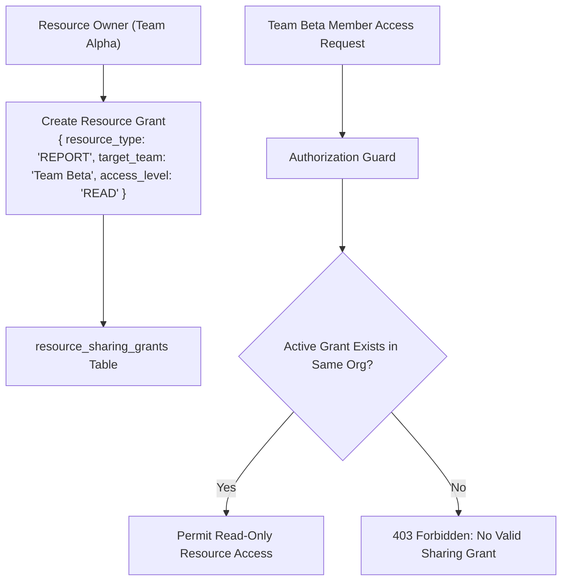

# P4-06 — Implement Controlled Resource Sharing Across Teams

**Parent Epic:** [Phase 4 — Enterprise Platform, Security & Scalability](../MILESTONE_PHASE_4.md)  
**Milestone:** [Phase 4 — Enterprise Platform, Security & Scalability](../MILESTONE_PHASE_4.md)  
**Workstream:** Workstream A — Organization & Team Administration  
**Status:** `ready-for-dev`  

---

## 🎯 Purpose

Allow approved sharing of selected organization resources while preserving strict workspace and tenant boundaries.

---

## 📐 Architecture & Workflow Diagram

---

## 📋 Detailed Requirements

- Define which resources may be shared across teams or workspaces (Scan Profiles, Findings, Reports).
- Implement explicit sharing grants rather than implicit access.
- Support read-only and permitted operational access levels where required.
- Define the resource owner and sharing authority.
- Allow authorized users to revoke sharing.
- Ensure sharing does not bypass finding, evidence, or report access controls.
- Record sharing creation, changes, and revocation.
- Define safe behavior when the source user or team loses access.
- Prevent cross-organization sharing unless explicitly supported by an approved architecture decision.

---

## 🛡️ Security & Architectural Invariants

- **Enterprise Multi-Tenancy:** Multi-organization and workspace hierarchy must never bypass or compromise the core tenant isolation boundaries established in ADR-0002.
- **Principle of Least Privilege:** RBAC/ABAC policy engines and service identity delegation must deny access by default and explicitly enforce permission scopes.
- **Tamper-Evident Auditability:** All administrative actions, SSO events, policy alterations, secret accesses, and integration invocations must emit structured, immutable audit log events.
- **Fail-Safe Operation:** Quotas, rate limits, distributed queue failovers, and webhook dispatchers must degrade gracefully without data loss, deadlocks, or silent failures.

---

## ✅ Acceptance Criteria

- [ ] Shareable resource types are explicitly defined.
- [ ] Sharing grants are validated by the authorization layer.
- [ ] Revoked grants immediately stop authorizing subsequent requests.
- [ ] Evidence and report access remain protected.
- [ ] Sharing decisions are auditable and tested.

---

## 🔗 Related Documentation & Links

- Enterprise Architecture Baseline: [`docs/architecture/SYSTEM_ARCHITECTURE.md`](../../../docs/architecture/SYSTEM_ARCHITECTURE.md)
- Multi-Tenancy & Isolation Model: [`docs/architecture/TENANT_ISOLATION.md`](../../../docs/architecture/TENANT_ISOLATION.md)
- Security Policies & Auditing: [`docs/security/AUDIT_SPECIFICATION.md`](../../../docs/security/AUDIT_SPECIFICATION.md)
- API & Webhook Specifications: [`docs/api/API_SPECIFICATION.md`](../../../docs/api/API_SPECIFICATION.md)
