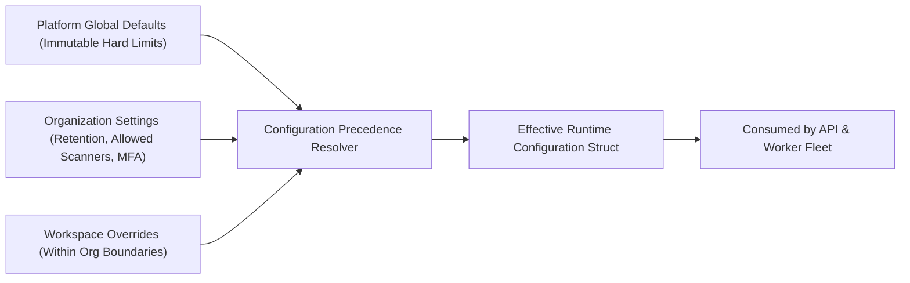

# P4-07 — Implement Organization-Level Settings and Configuration

**Parent Epic:** [Phase 4 — Enterprise Platform, Security & Scalability](../MILESTONE_PHASE_4.md)  
**Milestone:** [Phase 4 — Enterprise Platform, Security & Scalability](../MILESTONE_PHASE_4.md)  
**Workstream:** Workstream A — Organization & Team Administration  
**Status:** `ready-for-dev`  

---

## 🎯 Purpose

Allow enterprise administrators to manage organization-wide application preferences and approved security settings.

---

## 📐 Architecture & Workflow Diagram

---

## 📋 Detailed Requirements

- Define organization-level configuration categories.
- Support settings for: Default workspace behavior, Approved assessment profiles, Session and access preferences, Evidence retention options within platform limits, Integration preferences, Notification defaults, Security policy references.
- Define which settings can be customized and which are platform-enforced.
- Validate every configuration change against platform constraints.
- Prevent organization settings from weakening global security controls.
- Support versioned configuration changes.
- Record configuration history and actor information.
- Define precedence between platform defaults, organization settings, and workspace settings.

---

## 🛡️ Security & Architectural Invariants

- **Enterprise Multi-Tenancy:** Multi-organization and workspace hierarchy must never bypass or compromise the core tenant isolation boundaries established in ADR-0002.
- **Principle of Least Privilege:** RBAC/ABAC policy engines and service identity delegation must deny access by default and explicitly enforce permission scopes.
- **Tamper-Evident Auditability:** All administrative actions, SSO events, policy alterations, secret accesses, and integration invocations must emit structured, immutable audit log events.
- **Fail-Safe Operation:** Quotas, rate limits, distributed queue failovers, and webhook dispatchers must degrade gracefully without data loss, deadlocks, or silent failures.

---

## ✅ Acceptance Criteria

- [ ] Organization settings have a documented schema.
- [ ] Authorized administrators can change permitted settings.
- [ ] Platform-enforced controls cannot be overridden.
- [ ] Configuration precedence is deterministic.
- [ ] Changes are validated, versioned, and audited.

---

## 🔗 Related Documentation & Links

- Enterprise Architecture Baseline: [`docs/architecture/SYSTEM_ARCHITECTURE.md`](../../../docs/architecture/SYSTEM_ARCHITECTURE.md)
- Multi-Tenancy & Isolation Model: [`docs/architecture/TENANT_ISOLATION.md`](../../../docs/architecture/TENANT_ISOLATION.md)
- Security Policies & Auditing: [`docs/security/AUDIT_SPECIFICATION.md`](../../../docs/security/AUDIT_SPECIFICATION.md)
- API & Webhook Specifications: [`docs/api/API_SPECIFICATION.md`](../../../docs/api/API_SPECIFICATION.md)
