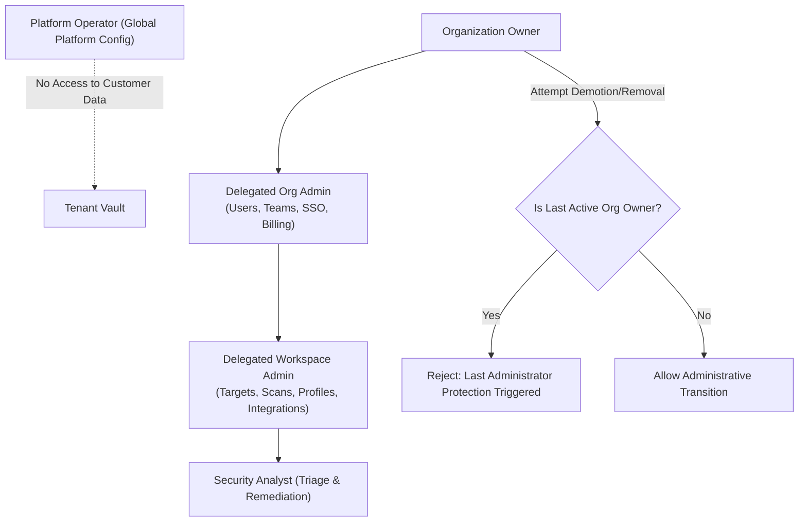

# P4-08 — Implement Delegated Organization and Workspace Administration

**Parent Epic:** [Phase 4 — Enterprise Platform, Security & Scalability](../MILESTONE_PHASE_4.md)  
**Milestone:** [Phase 4 — Enterprise Platform, Security & Scalability](../MILESTONE_PHASE_4.md)  
**Workstream:** Workstream A — Organization & Team Administration  
**Status:** `ready-for-dev`  

---

## 🎯 Purpose

Allow organizations to delegate administrative responsibilities without granting unrestricted platform-level privileges.

---

## 📐 Architecture & Workflow Diagram

---

## 📋 Detailed Requirements

- Define organization administrator and workspace administrator responsibilities.
- Support limited delegation of: User and team administration, Workspace settings, Assessment profile access, Integration configuration, Membership management.
- Restrict platform-level administrative capabilities to authorized platform operators.
- Prevent delegated administrators from modifying global platform security policies.
- Define privileged action boundaries.
- Require explicit authorization for role changes and privilege escalation.
- Log administrative actions.
- Add safeguards against removing the last active organization administrator.

---

## 🛡️ Security & Architectural Invariants

- **Enterprise Multi-Tenancy:** Multi-organization and workspace hierarchy must never bypass or compromise the core tenant isolation boundaries established in ADR-0002.
- **Principle of Least Privilege:** RBAC/ABAC policy engines and service identity delegation must deny access by default and explicitly enforce permission scopes.
- **Tamper-Evident Auditability:** All administrative actions, SSO events, policy alterations, secret accesses, and integration invocations must emit structured, immutable audit log events.
- **Fail-Safe Operation:** Quotas, rate limits, distributed queue failovers, and webhook dispatchers must degrade gracefully without data loss, deadlocks, or silent failures.

---

## ✅ Acceptance Criteria

- [ ] Administrative responsibilities are documented.
- [ ] Delegated administrators can perform only permitted actions.
- [ ] Platform-level privileges remain separately protected.
- [ ] Privileged changes are audited.
- [ ] Tests verify privilege escalation and last-administrator protections.

---

## 🔗 Related Documentation & Links

- Enterprise Architecture Baseline: [`docs/architecture/SYSTEM_ARCHITECTURE.md`](../../../docs/architecture/SYSTEM_ARCHITECTURE.md)
- Multi-Tenancy & Isolation Model: [`docs/architecture/TENANT_ISOLATION.md`](../../../docs/architecture/TENANT_ISOLATION.md)
- Security Policies & Auditing: [`docs/security/AUDIT_SPECIFICATION.md`](../../../docs/security/AUDIT_SPECIFICATION.md)
- API & Webhook Specifications: [`docs/api/API_SPECIFICATION.md`](../../../docs/api/API_SPECIFICATION.md)
