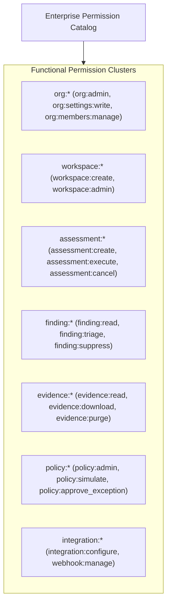

# P4-09 — Define the Enterprise Permission Catalog

**Parent Epic:** [Phase 4 — Enterprise Platform, Security & Scalability](../MILESTONE_PHASE_4.md)  
**Milestone:** [Phase 4 — Enterprise Platform, Security & Scalability](../MILESTONE_PHASE_4.md)  
**Workstream:** Workstream B — Enterprise Identity & Access Control  
**Status:** `ready-for-dev`  

---

## 🎯 Purpose

Create a formal permission catalog covering enterprise organization, workspace, assessment, finding, evidence, remediation, reporting, and integration operations.

---

## 📐 Architecture & Workflow Diagram

---

## 📋 Detailed Requirements

- Enumerate application permissions by resource and action (e.g. finding:triage, assessment:execute).
- Define read, create, update, delete, administer, approve, and execute permissions where applicable.
- Include organization and workspace administration permissions.
- Include privileged actions: Changing access assignments, Configuring SSO, Managing API credentials, Approving risk exceptions, Exporting sensitive evidence, Modifying enterprise policies.
- Define permission naming conventions.
- Separate application permissions from UI navigation visibility.
- Document sensitive permission combinations.
- Ensure permission definitions can be consumed by the Go authorization layer and TypeScript frontend.

---

## 🛡️ Security & Architectural Invariants

- **Enterprise Multi-Tenancy:** Multi-organization and workspace hierarchy must never bypass or compromise the core tenant isolation boundaries established in ADR-0002.
- **Principle of Least Privilege:** RBAC/ABAC policy engines and service identity delegation must deny access by default and explicitly enforce permission scopes.
- **Tamper-Evident Auditability:** All administrative actions, SSO events, policy alterations, secret accesses, and integration invocations must emit structured, immutable audit log events.
- **Fail-Safe Operation:** Quotas, rate limits, distributed queue failovers, and webhook dispatchers must degrade gracefully without data loss, deadlocks, or silent failures.

---

## ✅ Acceptance Criteria

- [ ] A complete permission catalog is documented.
- [ ] Each protected operation maps to one or more explicit permissions.
- [ ] Privileged actions are identified.
- [ ] Permission names and semantics are stable.
- [ ] Automated tests validate permission registration and coverage.

---

## 🔗 Related Documentation & Links

- Enterprise Architecture Baseline: [`docs/architecture/SYSTEM_ARCHITECTURE.md`](../../../docs/architecture/SYSTEM_ARCHITECTURE.md)
- Multi-Tenancy & Isolation Model: [`docs/architecture/TENANT_ISOLATION.md`](../../../docs/architecture/TENANT_ISOLATION.md)
- Security Policies & Auditing: [`docs/security/AUDIT_SPECIFICATION.md`](../../../docs/security/AUDIT_SPECIFICATION.md)
- API & Webhook Specifications: [`docs/api/API_SPECIFICATION.md`](../../../docs/api/API_SPECIFICATION.md)
