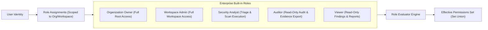

# P4-10 — Implement the Enterprise RBAC Role Model

**Parent Epic:** [Phase 4 — Enterprise Platform, Security & Scalability](../MILESTONE_PHASE_4.md)  
**Milestone:** [Phase 4 — Enterprise Platform, Security & Scalability](../MILESTONE_PHASE_4.md)  
**Workstream:** Workstream B — Enterprise Identity & Access Control  
**Status:** `ready-for-dev`  

---

## 🎯 Purpose

Extend the existing authorization system with enterprise roles and controlled permission assignments.

---

## 📐 Architecture & Workflow Diagram

---

## 📋 Detailed Requirements

- Define built-in roles: Organization Owner, Organization Administrator, Workspace Administrator, Security Administrator, Security Analyst, Auditor, Read-only Viewer.
- Map roles to the permission catalog from P4-09.
- Define role scope: platform, organization, workspace, or team.
- Ensure roles cannot be used outside their permitted scope.
- Define how users with multiple roles receive effective permissions (Union model with explicit Deny override).
- Explicitly define deny behavior where permissions conflict.
- Avoid implementing authorization exclusively through frontend conditionals.
- Provide a centralized role resolution service.
- Document role evolution and compatibility.

---

## 🛡️ Security & Architectural Invariants

- **Enterprise Multi-Tenancy:** Multi-organization and workspace hierarchy must never bypass or compromise the core tenant isolation boundaries established in ADR-0002.
- **Principle of Least Privilege:** RBAC/ABAC policy engines and service identity delegation must deny access by default and explicitly enforce permission scopes.
- **Tamper-Evident Auditability:** All administrative actions, SSO events, policy alterations, secret accesses, and integration invocations must emit structured, immutable audit log events.
- **Fail-Safe Operation:** Quotas, rate limits, distributed queue failovers, and webhook dispatchers must degrade gracefully without data loss, deadlocks, or silent failures.

---

## ✅ Acceptance Criteria

- [ ] Built-in enterprise roles are implemented.
- [ ] Role-to-permission mappings are testable.
- [ ] Scope restrictions are enforced server-side.
- [ ] Multiple role assignments resolve deterministically.
- [ ] Existing authorization tests remain passing.

---

## 🔗 Related Documentation & Links

- Enterprise Architecture Baseline: [`docs/architecture/SYSTEM_ARCHITECTURE.md`](../../../docs/architecture/SYSTEM_ARCHITECTURE.md)
- Multi-Tenancy & Isolation Model: [`docs/architecture/TENANT_ISOLATION.md`](../../../docs/architecture/TENANT_ISOLATION.md)
- Security Policies & Auditing: [`docs/security/AUDIT_SPECIFICATION.md`](../../../docs/security/AUDIT_SPECIFICATION.md)
- API & Webhook Specifications: [`docs/api/API_SPECIFICATION.md`](../../../docs/api/API_SPECIFICATION.md)
