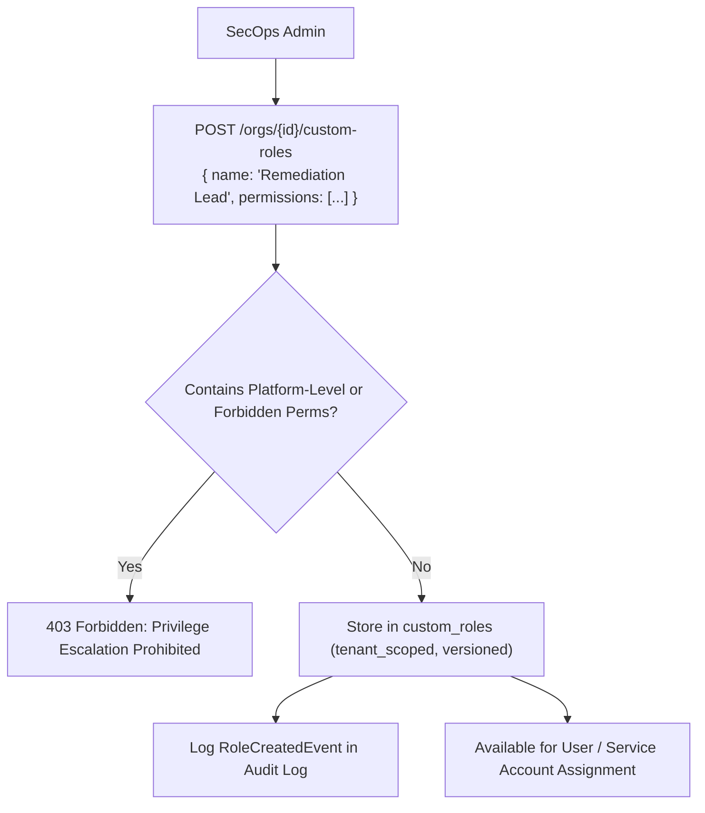

# P4-11 — Implement Custom Role Creation and Management

**Parent Epic:** [Phase 4 — Enterprise Platform, Security & Scalability](../MILESTONE_PHASE_4.md)  
**Milestone:** [Phase 4 — Enterprise Platform, Security & Scalability](../MILESTONE_PHASE_4.md)  
**Workstream:** Workstream B — Enterprise Identity & Access Control  
**Status:** `ready-for-dev`  

---

## 🎯 Purpose

Allow enterprises to define custom roles within the platform's approved permission model.

---

## 📐 Architecture & Workflow Diagram

---

## 📋 Detailed Requirements

- Support creation, editing, and archival of custom roles.
- Allow permitted administrators to select from the approved permission catalog.
- Define role scope and assignment boundaries.
- Prevent custom roles from containing platform-only permissions.
- Prevent escalation through combinations of otherwise permitted permissions.
- Restrict assignment of sensitive roles to authorized administrators.
- Define behavior when a role is modified after assignment.
- Preserve role version and assignment history.
- Prevent deletion of built-in roles.
- Define safeguards for roles currently assigned to users or service identities.

---

## 🛡️ Security & Architectural Invariants

- **Enterprise Multi-Tenancy:** Multi-organization and workspace hierarchy must never bypass or compromise the core tenant isolation boundaries established in ADR-0002.
- **Principle of Least Privilege:** RBAC/ABAC policy engines and service identity delegation must deny access by default and explicitly enforce permission scopes.
- **Tamper-Evident Auditability:** All administrative actions, SSO events, policy alterations, secret accesses, and integration invocations must emit structured, immutable audit log events.
- **Fail-Safe Operation:** Quotas, rate limits, distributed queue failovers, and webhook dispatchers must degrade gracefully without data loss, deadlocks, or silent failures.

---

## ✅ Acceptance Criteria

- [ ] Custom roles can be created from approved permissions.
- [ ] Restricted permissions cannot be granted through custom roles.
- [ ] Role changes are versioned and audited.
- [ ] Assigned-user behavior is deterministic after role updates.
- [ ] Authorization tests cover privilege escalation attempts.

---

## 🔗 Related Documentation & Links

- Enterprise Architecture Baseline: [`docs/architecture/SYSTEM_ARCHITECTURE.md`](../../../docs/architecture/SYSTEM_ARCHITECTURE.md)
- Multi-Tenancy & Isolation Model: [`docs/architecture/TENANT_ISOLATION.md`](../../../docs/architecture/TENANT_ISOLATION.md)
- Security Policies & Auditing: [`docs/security/AUDIT_SPECIFICATION.md`](../../../docs/security/AUDIT_SPECIFICATION.md)
- API & Webhook Specifications: [`docs/api/API_SPECIFICATION.md`](../../../docs/api/API_SPECIFICATION.md)
