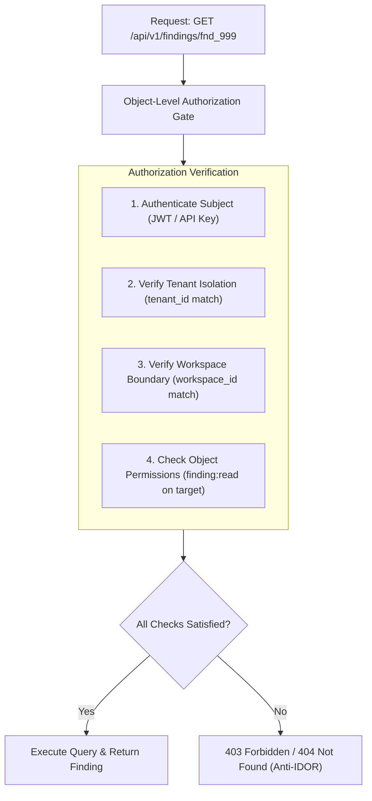

# P4-12 — Implement Resource-Level and Object-Level Authorization

**Parent Epic:** [Phase 4 — Enterprise Platform, Security & Scalability](../MILESTONE_PHASE_4.md)  
**Milestone:** [Phase 4 — Enterprise Platform, Security & Scalability](../MILESTONE_PHASE_4.md)  
**Workstream:** Workstream B — Enterprise Identity & Access Control  
**Status:** `ready-for-dev`  

---

## 🎯 Purpose

Extend RBAC with resource-level checks so users can access only the specific findings, assessments, evidence, reports, and integrations permitted by their assignments.

---

## 📐 Architecture & Workflow Diagram

---

## 📋 Detailed Requirements

- Define resource-level authorization semantics.
- Integrate authorization checks into application services and repository access paths.
- Support explicit team or workspace access boundaries.
- Enforce authorization for direct object references.
- Apply permissions consistently across API, exports, downloads, background jobs, and integration operations.
- Define read-only restrictions.
- Prevent IDOR vulnerabilities.
- Use centralized policy evaluation instead of duplicating permission checks inconsistently.
- Ensure object ownership and tenant scope are independently verified.

---

## 🛡️ Security & Architectural Invariants

- **Enterprise Multi-Tenancy:** Multi-organization and workspace hierarchy must never bypass or compromise the core tenant isolation boundaries established in ADR-0002.
- **Principle of Least Privilege:** RBAC/ABAC policy engines and service identity delegation must deny access by default and explicitly enforce permission scopes.
- **Tamper-Evident Auditability:** All administrative actions, SSO events, policy alterations, secret accesses, and integration invocations must emit structured, immutable audit log events.
- **Fail-Safe Operation:** Quotas, rate limits, distributed queue failovers, and webhook dispatchers must degrade gracefully without data loss, deadlocks, or silent failures.

---

## ✅ Acceptance Criteria

- [ ] Protected resource access performs server-side authorization.
- [ ] Direct object identifier guessing cannot bypass permission checks.
- [ ] API and download paths enforce equivalent restrictions.
- [ ] Background jobs preserve authorized context.
- [ ] Automated negative tests cover unauthorized object access.

---

## 🔗 Related Documentation & Links

- Enterprise Architecture Baseline: [`docs/architecture/SYSTEM_ARCHITECTURE.md`](../../../docs/architecture/SYSTEM_ARCHITECTURE.md)
- Multi-Tenancy & Isolation Model: [`docs/architecture/TENANT_ISOLATION.md`](../../../docs/architecture/TENANT_ISOLATION.md)
- Security Policies & Auditing: [`docs/security/AUDIT_SPECIFICATION.md`](../../../docs/security/AUDIT_SPECIFICATION.md)
- API & Webhook Specifications: [`docs/api/API_SPECIFICATION.md`](../../../docs/api/API_SPECIFICATION.md)
