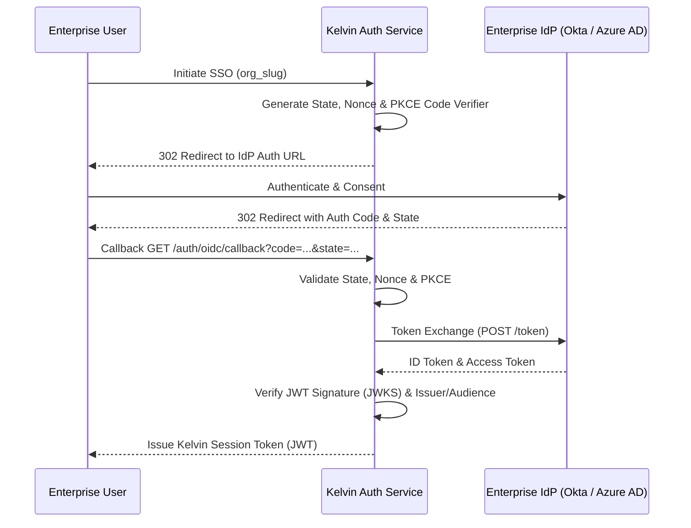

# P4-13 — Implement OpenID Connect Enterprise SSO

**Parent Epic:** [Phase 4 — Enterprise Platform, Security & Scalability](../MILESTONE_PHASE_4.md)  
**Milestone:** [Phase 4 — Enterprise Platform, Security & Scalability](../MILESTONE_PHASE_4.md)  
**Workstream:** Workstream B — Enterprise Identity & Access Control  
**Status:** `ready-for-dev`  

---

## 🎯 Purpose

Allow enterprise organizations to authenticate users through their supported OpenID Connect identity provider.

---

## 📐 Architecture & Workflow Diagram

---

## 📋 Detailed Requirements

- Implement a standards-based OIDC integration (Okta, Azure AD, Ping, Keycloak).
- Support administrator-managed identity-provider configuration.
- Validate issuer, audience, signature, and token validity.
- Validate state and nonce values during authentication.
- Use authorization code flow with PKCE protections.
- Define redirect URI registration and strict validation.
- Map identity-provider claims to KELVIN user identity.
- Separate authentication from organization membership and authorization.
- Handle IdP unavailability and authentication errors safely.
- Never trust unverified token claims.

---

## 🛡️ Security & Architectural Invariants

- **Enterprise Multi-Tenancy:** Multi-organization and workspace hierarchy must never bypass or compromise the core tenant isolation boundaries established in ADR-0002.
- **Principle of Least Privilege:** RBAC/ABAC policy engines and service identity delegation must deny access by default and explicitly enforce permission scopes.
- **Tamper-Evident Auditability:** All administrative actions, SSO events, policy alterations, secret accesses, and integration invocations must emit structured, immutable audit log events.
- **Fail-Safe Operation:** Quotas, rate limits, distributed queue failovers, and webhook dispatchers must degrade gracefully without data loss, deadlocks, or silent failures.

---

## ✅ Acceptance Criteria

- [ ] An authorized organization can configure a supported OIDC provider.
- [ ] Authentication tokens are fully validated.
- [ ] State, nonce, redirect, and issuer checks are enforced.
- [ ] Successful authentication does not bypass organization authorization.
- [ ] Security tests cover invalid tokens, replay, and redirect manipulation.

---

## 🔗 Related Documentation & Links

- Enterprise Architecture Baseline: [`docs/architecture/SYSTEM_ARCHITECTURE.md`](../../../docs/architecture/SYSTEM_ARCHITECTURE.md)
- Multi-Tenancy & Isolation Model: [`docs/architecture/TENANT_ISOLATION.md`](../../../docs/architecture/TENANT_ISOLATION.md)
- Security Policies & Auditing: [`docs/security/AUDIT_SPECIFICATION.md`](../../../docs/security/AUDIT_SPECIFICATION.md)
- API & Webhook Specifications: [`docs/api/API_SPECIFICATION.md`](../../../docs/api/API_SPECIFICATION.md)
