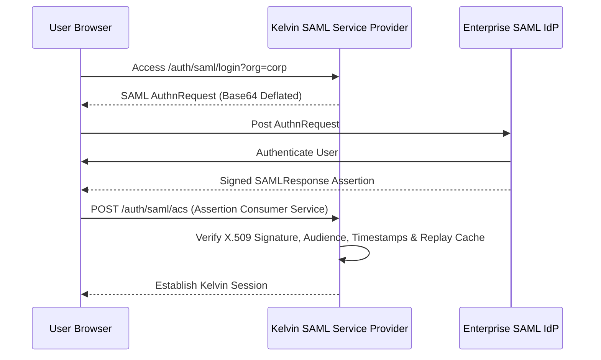

# P4-14 — Implement SAML 2.0 Enterprise SSO

**Parent Epic:** [Phase 4 — Enterprise Platform, Security & Scalability](../MILESTONE_PHASE_4.md)  
**Milestone:** [Phase 4 — Enterprise Platform, Security & Scalability](../MILESTONE_PHASE_4.md)  
**Workstream:** Workstream B — Enterprise Identity & Access Control  
**Status:** `ready-for-dev`  

---

## 🎯 Purpose

Support enterprises whose identity providers use SAML 2.0 federation.

---

## 📐 Architecture & Workflow Diagram

---

## 📋 Detailed Requirements

- Define the supported SAML integration profile (SP-Initiated).
- Implement the service-provider authentication flow.
- Validate assertion signatures and trusted certificates.
- Validate issuer, audience, recipient, destination, and time conditions (NotOnOrAfter).
- Prevent replay of authentication assertions.
- Validate allowed identity-provider metadata.
- Define secure certificate rollover procedures.
- Map SAML attributes to KELVIN identities and organization memberships.
- Ensure login does not imply unrestricted resource access.
- Document unsupported or restricted SAML features.

---

## 🛡️ Security & Architectural Invariants

- **Enterprise Multi-Tenancy:** Multi-organization and workspace hierarchy must never bypass or compromise the core tenant isolation boundaries established in ADR-0002.
- **Principle of Least Privilege:** RBAC/ABAC policy engines and service identity delegation must deny access by default and explicitly enforce permission scopes.
- **Tamper-Evident Auditability:** All administrative actions, SSO events, policy alterations, secret accesses, and integration invocations must emit structured, immutable audit log events.
- **Fail-Safe Operation:** Quotas, rate limits, distributed queue failovers, and webhook dispatchers must degrade gracefully without data loss, deadlocks, or silent failures.

---

## ✅ Acceptance Criteria

- [ ] Approved SAML providers can authenticate users.
- [ ] Assertions are fully validated.
- [ ] Replay and audience validation are enforced.
- [ ] Certificate configuration is controlled and auditable.
- [ ] Negative security tests cover invalid and expired assertions.

---

## 🔗 Related Documentation & Links

- Enterprise Architecture Baseline: [`docs/architecture/SYSTEM_ARCHITECTURE.md`](../../../docs/architecture/SYSTEM_ARCHITECTURE.md)
- Multi-Tenancy & Isolation Model: [`docs/architecture/TENANT_ISOLATION.md`](../../../docs/architecture/TENANT_ISOLATION.md)
- Security Policies & Auditing: [`docs/security/AUDIT_SPECIFICATION.md`](../../../docs/security/AUDIT_SPECIFICATION.md)
- API & Webhook Specifications: [`docs/api/API_SPECIFICATION.md`](../../../docs/api/API_SPECIFICATION.md)
