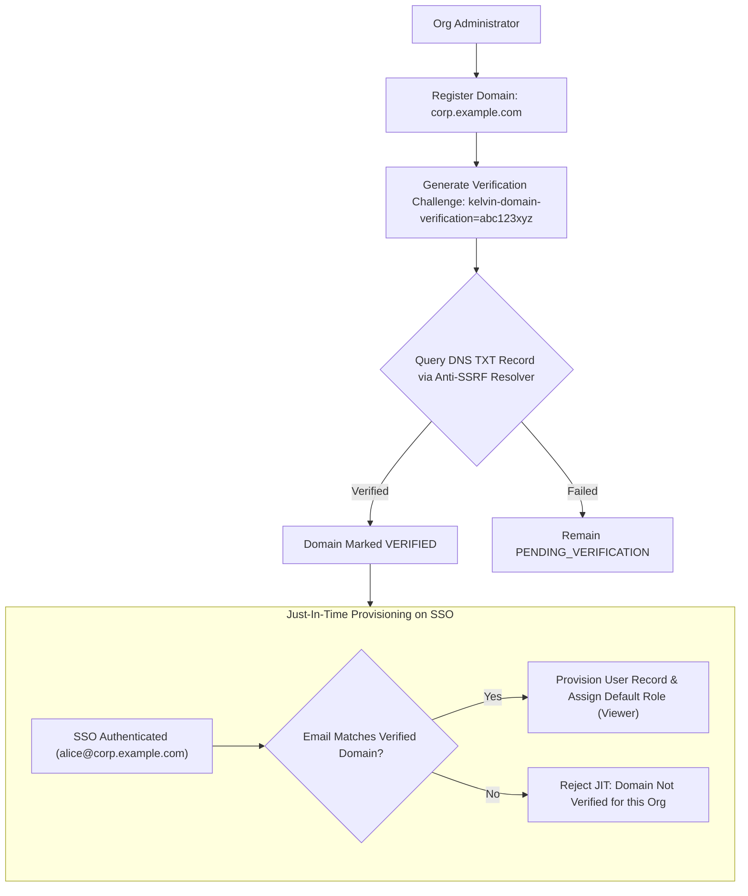

# P4-15 — Implement Enterprise Domain Verification and JIT Provisioning

**Parent Epic:** [Phase 4 — Enterprise Platform, Security & Scalability](../MILESTONE_PHASE_4.md)  
**Milestone:** [Phase 4 — Enterprise Platform, Security & Scalability](../MILESTONE_PHASE_4.md)  
**Workstream:** Workstream B — Enterprise Identity & Access Control  
**Status:** `ready-for-dev`  

---

## 🎯 Purpose

Allow an organization to verify its email domain and optionally provision users during successful SSO authentication.

---

## 📐 Architecture & Workflow Diagram

---

## 📋 Detailed Requirements

- Implement domain ownership verification using a DNS TXT challenge.
- Prevent multiple organizations from claiming the same verified domain without an explicit approved transfer process.
- Define domain verification expiry and revalidation (e.g. 180 days).
- Support just-in-time user provisioning after successful SSO.
- Map verified identity claims to organization membership.
- Define default roles for newly provisioned users (e.g. Viewer).
- Prevent unverified email claims from creating privileged accounts.
- Support controlled deprovisioning and account linking.
- Record provisioning decisions and outcomes.

---

## 🛡️ Security & Architectural Invariants

- **Enterprise Multi-Tenancy:** Multi-organization and workspace hierarchy must never bypass or compromise the core tenant isolation boundaries established in ADR-0002.
- **Principle of Least Privilege:** RBAC/ABAC policy engines and service identity delegation must deny access by default and explicitly enforce permission scopes.
- **Tamper-Evident Auditability:** All administrative actions, SSO events, policy alterations, secret accesses, and integration invocations must emit structured, immutable audit log events.
- **Fail-Safe Operation:** Quotas, rate limits, distributed queue failovers, and webhook dispatchers must degrade gracefully without data loss, deadlocks, or silent failures.

---

## ✅ Acceptance Criteria

- [ ] Domain ownership can be verified.
- [ ] Unverified domains cannot enable domain-based automatic membership.
- [ ] JIT provisioning applies only approved roles.
- [ ] Account linking prevents unauthorized identity takeover.
- [ ] Verification and provisioning events are auditable.

---

## 🔗 Related Documentation & Links

- Enterprise Architecture Baseline: [`docs/architecture/SYSTEM_ARCHITECTURE.md`](../../../docs/architecture/SYSTEM_ARCHITECTURE.md)
- Multi-Tenancy & Isolation Model: [`docs/architecture/TENANT_ISOLATION.md`](../../../docs/architecture/TENANT_ISOLATION.md)
- Security Policies & Auditing: [`docs/security/AUDIT_SPECIFICATION.md`](../../../docs/security/AUDIT_SPECIFICATION.md)
- API & Webhook Specifications: [`docs/api/API_SPECIFICATION.md`](../../../docs/api/API_SPECIFICATION.md)
