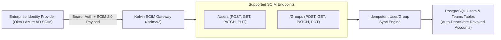

# P4-16 — Implement SCIM 2.0 User and Group Provisioning

**Parent Epic:** [Phase 4 — Enterprise Platform, Security & Scalability](../MILESTONE_PHASE_4.md)  
**Milestone:** [Phase 4 — Enterprise Platform, Security & Scalability](../MILESTONE_PHASE_4.md)  
**Workstream:** Workstream B — Enterprise Identity & Access Control  
**Status:** `ready-for-dev`  

---

## 🎯 Purpose

Allow enterprise identity providers to provision and deprovision users and groups through a standardized SCIM interface.

---

## 📐 Architecture & Workflow Diagram

---

## 📋 Detailed Requirements

- Define the supported SCIM 2.0 resource profile (RFC 7643 / RFC 7644).
- Support /scim/v2/Users: create, update, lookup, deactivate (PATCH active=false).
- Support /scim/v2/Groups: creation and membership updates.
- Authenticate SCIM clients securely via scoped bearer tokens.
- Enforce organization-specific provisioning boundaries.
- Handle duplicate identity references safely.
- Define mapping from SCIM groups to KELVIN teams or roles.
- Prevent external provisioning from granting platform-level privileges.
- Support pagination, filtering, and standards-compliant error responses.
- Make provisioning operations idempotent and auditable.

---

## 🛡️ Security & Architectural Invariants

- **Enterprise Multi-Tenancy:** Multi-organization and workspace hierarchy must never bypass or compromise the core tenant isolation boundaries established in ADR-0002.
- **Principle of Least Privilege:** RBAC/ABAC policy engines and service identity delegation must deny access by default and explicitly enforce permission scopes.
- **Tamper-Evident Auditability:** All administrative actions, SSO events, policy alterations, secret accesses, and integration invocations must emit structured, immutable audit log events.
- **Fail-Safe Operation:** Quotas, rate limits, distributed queue failovers, and webhook dispatchers must degrade gracefully without data loss, deadlocks, or silent failures.

---

## ✅ Acceptance Criteria

- [ ] Supported SCIM operations behave according to the documented profile.
- [ ] Provisioning is organization-scoped.
- [ ] Repeated operations are safe.
- [ ] Deactivated users lose applicable access according to policy.
- [ ] Group synchronization cannot grant unauthorized privileges.
- [ ] SCIM integration tests pass.

---

## 🔗 Related Documentation & Links

- Enterprise Architecture Baseline: [`docs/architecture/SYSTEM_ARCHITECTURE.md`](../../../docs/architecture/SYSTEM_ARCHITECTURE.md)
- Multi-Tenancy & Isolation Model: [`docs/architecture/TENANT_ISOLATION.md`](../../../docs/architecture/TENANT_ISOLATION.md)
- Security Policies & Auditing: [`docs/security/AUDIT_SPECIFICATION.md`](../../../docs/security/AUDIT_SPECIFICATION.md)
- API & Webhook Specifications: [`docs/api/API_SPECIFICATION.md`](../../../docs/api/API_SPECIFICATION.md)
