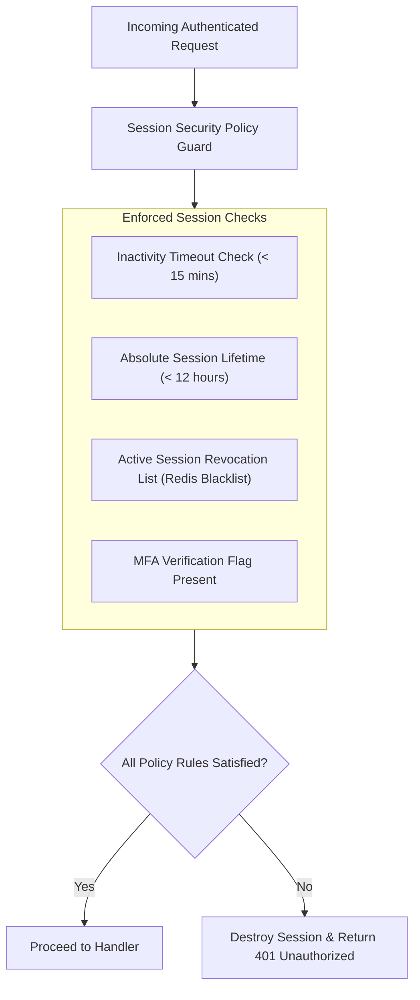

# P4-17 — Implement Enterprise Session and MFA Security Policies

**Parent Epic:** [Phase 4 — Enterprise Platform, Security & Scalability](../MILESTONE_PHASE_4.md)  
**Milestone:** [Phase 4 — Enterprise Platform, Security & Scalability](../MILESTONE_PHASE_4.md)  
**Workstream:** Workstream B — Enterprise Identity & Access Control  
**Status:** `ready-for-dev`  

---

## 🎯 Purpose

Give organizations control over authentication strength and session security within platform-enforced limits.

---

## 📐 Architecture & Workflow Diagram

---

## 📋 Detailed Requirements

- Define session lifetime and inactivity timeout settings (e.g. 15m idle timeout).
- Support immediate session revocation.
- Define concurrent session behavior (limit max sessions per user).
- Provide secure logout and account-session invalidation.
- Support MFA requirements for supported authentication paths (TOTP / WebAuthn FIDO2).
- Define interaction with identity-provider-enforced MFA.
- Prevent users from bypassing an organization-required authentication policy.
- Require reauthentication for selected high-risk actions (e.g. API key generation, role modifications).
- Avoid weakening platform security through organization configuration.
- Audit policy changes and privileged authentication events.

---

## 🛡️ Security & Architectural Invariants

- **Enterprise Multi-Tenancy:** Multi-organization and workspace hierarchy must never bypass or compromise the core tenant isolation boundaries established in ADR-0002.
- **Principle of Least Privilege:** RBAC/ABAC policy engines and service identity delegation must deny access by default and explicitly enforce permission scopes.
- **Tamper-Evident Auditability:** All administrative actions, SSO events, policy alterations, secret accesses, and integration invocations must emit structured, immutable audit log events.
- **Fail-Safe Operation:** Quotas, rate limits, distributed queue failovers, and webhook dispatchers must degrade gracefully without data loss, deadlocks, or silent failures.

---

## ✅ Acceptance Criteria

- [ ] Session policy is enforced server-side.
- [ ] Revoked sessions cannot continue accessing protected operations.
- [ ] MFA requirements follow the configured organization policy.
- [ ] Sensitive actions can require reauthentication.
- [ ] Tests cover expiry, revocation, and policy bypass attempts.

---

## 🔗 Related Documentation & Links

- Enterprise Architecture Baseline: [`docs/architecture/SYSTEM_ARCHITECTURE.md`](../../../docs/architecture/SYSTEM_ARCHITECTURE.md)
- Multi-Tenancy & Isolation Model: [`docs/architecture/TENANT_ISOLATION.md`](../../../docs/architecture/TENANT_ISOLATION.md)
- Security Policies & Auditing: [`docs/security/AUDIT_SPECIFICATION.md`](../../../docs/security/AUDIT_SPECIFICATION.md)
- API & Webhook Specifications: [`docs/api/API_SPECIFICATION.md`](../../../docs/api/API_SPECIFICATION.md)
