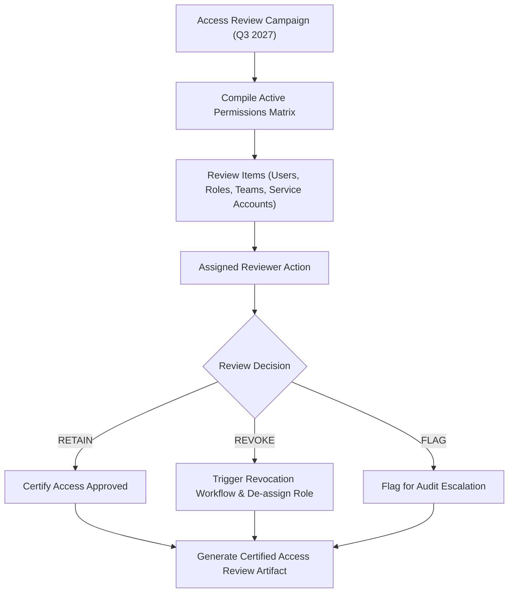

# P4-18 — Implement Enterprise Access Review and Certification

**Parent Epic:** [Phase 4 — Enterprise Platform, Security & Scalability](../MILESTONE_PHASE_4.md)  
**Milestone:** [Phase 4 — Enterprise Platform, Security & Scalability](../MILESTONE_PHASE_4.md)  
**Workstream:** Workstream B — Enterprise Identity & Access Control  
**Status:** `ready-for-dev`  

---

## 🎯 Purpose

Provide administrators and auditors with a way to review user, team, role, and service-identity access assignments.

---

## 📐 Architecture & Workflow Diagram

---

## 📋 Detailed Requirements

- Define access review scope and cadence (quarterly, annual, ad-hoc).
- Support review of: Organization members, Workspace memberships, Team membership, Role assignments, Custom roles, Service identities, API credential ownership.
- Record reviewer identity and review period.
- Support decisions: retain, revoke, investigate.
- Record justification for sensitive decisions.
- Prevent a reviewer from modifying their own privileged assignments through an unapproved workflow.
- Generate review completion status.
- Preserve review history.

---

## 🛡️ Security & Architectural Invariants

- **Enterprise Multi-Tenancy:** Multi-organization and workspace hierarchy must never bypass or compromise the core tenant isolation boundaries established in ADR-0002.
- **Principle of Least Privilege:** RBAC/ABAC policy engines and service identity delegation must deny access by default and explicitly enforce permission scopes.
- **Tamper-Evident Auditability:** All administrative actions, SSO events, policy alterations, secret accesses, and integration invocations must emit structured, immutable audit log events.
- **Fail-Safe Operation:** Quotas, rate limits, distributed queue failovers, and webhook dispatchers must degrade gracefully without data loss, deadlocks, or silent failures.

---

## ✅ Acceptance Criteria

- [ ] Authorized administrators can initiate and complete access reviews.
- [ ] Review decisions are recorded.
- [ ] Revocation operations trigger the relevant access invalidation.
- [ ] Review history is retained and searchable.
- [ ] Tests cover unauthorized reviewer actions and incomplete reviews.

---

## 🔗 Related Documentation & Links

- Enterprise Architecture Baseline: [`docs/architecture/SYSTEM_ARCHITECTURE.md`](../../../docs/architecture/SYSTEM_ARCHITECTURE.md)
- Multi-Tenancy & Isolation Model: [`docs/architecture/TENANT_ISOLATION.md`](../../../docs/architecture/TENANT_ISOLATION.md)
- Security Policies & Auditing: [`docs/security/AUDIT_SPECIFICATION.md`](../../../docs/security/AUDIT_SPECIFICATION.md)
- API & Webhook Specifications: [`docs/api/API_SPECIFICATION.md`](../../../docs/api/API_SPECIFICATION.md)
