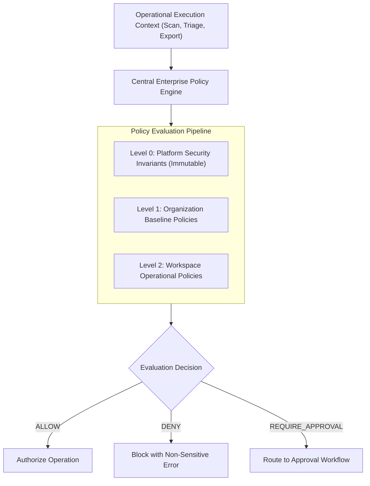

# P4-19 — Define the Centralized Enterprise Policy Engine Architecture

**Parent Epic:** [Phase 4 — Enterprise Platform, Security & Scalability](../MILESTONE_PHASE_4.md)  
**Milestone:** [Phase 4 — Enterprise Platform, Security & Scalability](../MILESTONE_PHASE_4.md)  
**Workstream:** Workstream C — Policy & Workflow Governance  
**Status:** `ready-for-dev`  

---

## 🎯 Purpose

Establish a centralized mechanism for evaluating organization and workspace policies consistently across API requests, assessment creation, scanner execution, and finding workflows.

---

## 📐 Architecture & Workflow Diagram

---

## 📋 Detailed Requirements

- Define policy types and supported evaluation contexts.
- Separate policy definitions from policy evaluation and enforcement.
- Define policy scope: platform, organization, workspace, or target.
- Define precedence and conflict-resolution rules.
- Support deterministic policy decisions.
- Define policy versioning and change history.
- Prevent policy evaluation from relying on frontend-only state.
- Define safe failure behavior when a policy cannot be evaluated (Fail-Closed).
- Provide explainable policy decision results.
- Ensure policies cannot override platform-level security boundaries.

---

## 🛡️ Security & Architectural Invariants

- **Enterprise Multi-Tenancy:** Multi-organization and workspace hierarchy must never bypass or compromise the core tenant isolation boundaries established in ADR-0002.
- **Principle of Least Privilege:** RBAC/ABAC policy engines and service identity delegation must deny access by default and explicitly enforce permission scopes.
- **Tamper-Evident Auditability:** All administrative actions, SSO events, policy alterations, secret accesses, and integration invocations must emit structured, immutable audit log events.
- **Fail-Safe Operation:** Quotas, rate limits, distributed queue failovers, and webhook dispatchers must degrade gracefully without data loss, deadlocks, or silent failures.

---

## ✅ Acceptance Criteria

- [ ] Policy architecture is documented and approved.
- [ ] Evaluation and enforcement boundaries are explicit.
- [ ] Policy precedence is deterministic.
- [ ] Failure behavior is defined.
- [ ] The architecture supports future policy types without scanner-specific coupling.

---

## 🔗 Related Documentation & Links

- Enterprise Architecture Baseline: [`docs/architecture/SYSTEM_ARCHITECTURE.md`](../../../docs/architecture/SYSTEM_ARCHITECTURE.md)
- Multi-Tenancy & Isolation Model: [`docs/architecture/TENANT_ISOLATION.md`](../../../docs/architecture/TENANT_ISOLATION.md)
- Security Policies & Auditing: [`docs/security/AUDIT_SPECIFICATION.md`](../../../docs/security/AUDIT_SPECIFICATION.md)
- API & Webhook Specifications: [`docs/api/API_SPECIFICATION.md`](../../../docs/api/API_SPECIFICATION.md)
