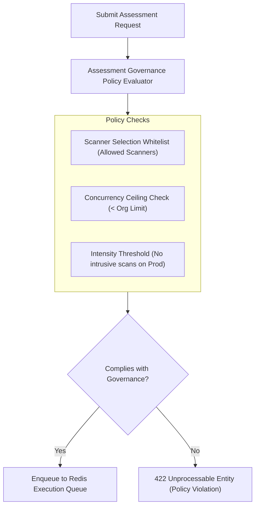

# P4-20 — Implement Organization Assessment Governance Policies

**Parent Epic:** [Phase 4 — Enterprise Platform, Security & Scalability](../MILESTONE_PHASE_4.md)  
**Milestone:** [Phase 4 — Enterprise Platform, Security & Scalability](../MILESTONE_PHASE_4.md)  
**Workstream:** Workstream C — Policy & Workflow Governance  
**Status:** `ready-for-dev`  

---

## 🎯 Purpose

Allow organizations to enforce consistent assessment rules beyond the basic scan profiles and limits from Phase 2.

---

## 📐 Architecture & Workflow Diagram

---

## 📋 Detailed Requirements

- Define policies for approved assessment types and target categories.
- Support restrictions on assessment profile selection.
- Allow policies to enforce approved scanner sets.
- Allow organization-level request and concurrency ceilings within platform limits.
- Define allowed assessment windows and scheduling restrictions where required.
- Reject assessment requests that violate policy.
- Return clear, non-sensitive policy rejection reasons.
- Apply the same policy evaluation to API and UI submissions.
- Record the policy version used for an assessment.

---

## 🛡️ Security & Architectural Invariants

- **Enterprise Multi-Tenancy:** Multi-organization and workspace hierarchy must never bypass or compromise the core tenant isolation boundaries established in ADR-0002.
- **Principle of Least Privilege:** RBAC/ABAC policy engines and service identity delegation must deny access by default and explicitly enforce permission scopes.
- **Tamper-Evident Auditability:** All administrative actions, SSO events, policy alterations, secret accesses, and integration invocations must emit structured, immutable audit log events.
- **Fail-Safe Operation:** Quotas, rate limits, distributed queue failovers, and webhook dispatchers must degrade gracefully without data loss, deadlocks, or silent failures.

---

## ✅ Acceptance Criteria

- [ ] Organization assessment policies can be configured.
- [ ] Assessment creation enforces applicable policies.
- [ ] UI and API requests receive consistent decisions.
- [ ] Platform limits cannot be exceeded.
- [ ] Policy version and evaluation outcome are traceable.

---

## 🔗 Related Documentation & Links

- Enterprise Architecture Baseline: [`docs/architecture/SYSTEM_ARCHITECTURE.md`](../../../docs/architecture/SYSTEM_ARCHITECTURE.md)
- Multi-Tenancy & Isolation Model: [`docs/architecture/TENANT_ISOLATION.md`](../../../docs/architecture/TENANT_ISOLATION.md)
- Security Policies & Auditing: [`docs/security/AUDIT_SPECIFICATION.md`](../../../docs/security/AUDIT_SPECIFICATION.md)
- API & Webhook Specifications: [`docs/api/API_SPECIFICATION.md`](../../../docs/api/API_SPECIFICATION.md)
