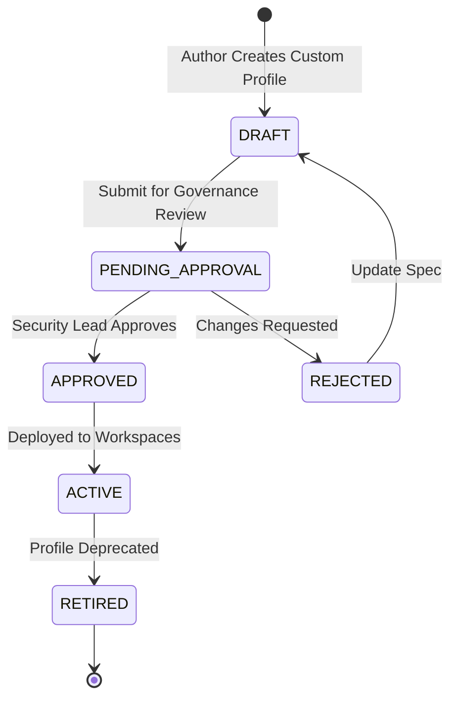

# P4-21 — Implement Scan Profile Approval and Governance

**Parent Epic:** [Phase 4 — Enterprise Platform, Security & Scalability](../MILESTONE_PHASE_4.md)  
**Milestone:** [Phase 4 — Enterprise Platform, Security & Scalability](../MILESTONE_PHASE_4.md)  
**Workstream:** Workstream C — Policy & Workflow Governance  
**Status:** `ready-for-dev`  

---

## 🎯 Purpose

Allow enterprise administrators to control which scan profiles are available and which require approval before use.

---

## 📐 Architecture & Workflow Diagram

---

## 📋 Detailed Requirements

- Define organization-approved scan profile states.
- Support approval, rejection, retirement, and version changes.
- Allow organizations to restrict access to selected profiles.
- Define approval requirements for more intensive assessment profiles.
- Ensure a profile version cannot be silently changed after approval.
- Record the approving administrator and approval time.
- Enforce approved profile configuration at assessment creation and execution.
- Define behavior when an approved profile is retired while assessments are queued.
- Preserve profile history for prior assessments.

---

## 🛡️ Security & Architectural Invariants

- **Enterprise Multi-Tenancy:** Multi-organization and workspace hierarchy must never bypass or compromise the core tenant isolation boundaries established in ADR-0002.
- **Principle of Least Privilege:** RBAC/ABAC policy engines and service identity delegation must deny access by default and explicitly enforce permission scopes.
- **Tamper-Evident Auditability:** All administrative actions, SSO events, policy alterations, secret accesses, and integration invocations must emit structured, immutable audit log events.
- **Fail-Safe Operation:** Quotas, rate limits, distributed queue failovers, and webhook dispatchers must degrade gracefully without data loss, deadlocks, or silent failures.

---

## ✅ Acceptance Criteria

- [ ] Profile approval lifecycle is implemented.
- [ ] Unapproved or retired profiles cannot be used where prohibited.
- [ ] Approved versions are immutable or versioned.
- [ ] Queued assessment behavior is deterministic.
- [ ] Approval operations are audited and tested.

---

## 🔗 Related Documentation & Links

- Enterprise Architecture Baseline: [`docs/architecture/SYSTEM_ARCHITECTURE.md`](../../../docs/architecture/SYSTEM_ARCHITECTURE.md)
- Multi-Tenancy & Isolation Model: [`docs/architecture/TENANT_ISOLATION.md`](../../../docs/architecture/TENANT_ISOLATION.md)
- Security Policies & Auditing: [`docs/security/AUDIT_SPECIFICATION.md`](../../../docs/security/AUDIT_SPECIFICATION.md)
- API & Webhook Specifications: [`docs/api/API_SPECIFICATION.md`](../../../docs/api/API_SPECIFICATION.md)
