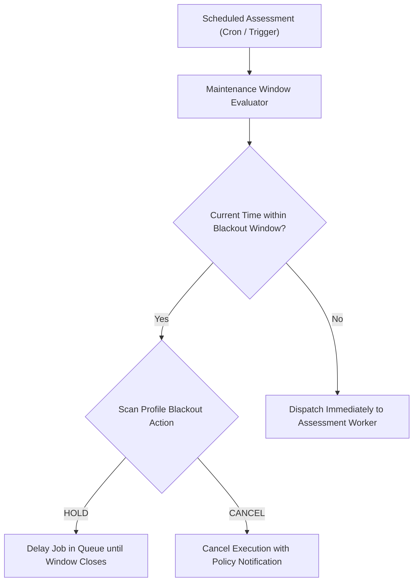

# P4-22 — Implement Assessment Scheduling and Maintenance-Window Policies

**Parent Epic:** [Phase 4 — Enterprise Platform, Security & Scalability](../MILESTONE_PHASE_4.md)  
**Milestone:** [Phase 4 — Enterprise Platform, Security & Scalability](../MILESTONE_PHASE_4.md)  
**Workstream:** Workstream C — Policy & Workflow Governance  
**Status:** `ready-for-dev`  

---

## 🎯 Purpose

Allow organizations to govern when assessments may start and execute.

---

## 📐 Architecture & Workflow Diagram

---

## 📋 Detailed Requirements

- Support approved scheduling windows.
- Define organization and workspace time-zone handling.
- Support maintenance windows and blackout periods (e.g. peak business hours).
- Apply policies to scheduled and manually triggered assessments as configured.
- Define behavior when an assessment is queued before a blackout period but starts during it.
- Avoid ambiguous daylight-saving and time-zone handling.
- Allow authorized exception workflows where supported.
- Preserve original requested schedule and actual execution time.
- Avoid implementing an unrestricted scheduling engine that bypasses Phase 2 queue and concurrency controls.

---

## 🛡️ Security & Architectural Invariants

- **Enterprise Multi-Tenancy:** Multi-organization and workspace hierarchy must never bypass or compromise the core tenant isolation boundaries established in ADR-0002.
- **Principle of Least Privilege:** RBAC/ABAC policy engines and service identity delegation must deny access by default and explicitly enforce permission scopes.
- **Tamper-Evident Auditability:** All administrative actions, SSO events, policy alterations, secret accesses, and integration invocations must emit structured, immutable audit log events.
- **Fail-Safe Operation:** Quotas, rate limits, distributed queue failovers, and webhook dispatchers must degrade gracefully without data loss, deadlocks, or silent failures.

---

## ✅ Acceptance Criteria

- [ ] Scheduling windows are enforced.
- [ ] Time-zone semantics are explicit.
- [ ] Blackout periods are respected.
- [ ] Queued assessments follow documented rules.
- [ ] Schedule-policy decisions are auditable and tested.

---

## 🔗 Related Documentation & Links

- Enterprise Architecture Baseline: [`docs/architecture/SYSTEM_ARCHITECTURE.md`](../../../docs/architecture/SYSTEM_ARCHITECTURE.md)
- Multi-Tenancy & Isolation Model: [`docs/architecture/TENANT_ISOLATION.md`](../../../docs/architecture/TENANT_ISOLATION.md)
- Security Policies & Auditing: [`docs/security/AUDIT_SPECIFICATION.md`](../../../docs/security/AUDIT_SPECIFICATION.md)
- API & Webhook Specifications: [`docs/api/API_SPECIFICATION.md`](../../../docs/api/API_SPECIFICATION.md)
