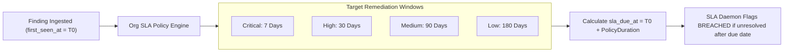

# P4-23 — Implement Finding SLA and Priority Governance

**Parent Epic:** [Phase 4 — Enterprise Platform, Security & Scalability](../MILESTONE_PHASE_4.md)  
**Milestone:** [Phase 4 — Enterprise Platform, Security & Scalability](../MILESTONE_PHASE_4.md)  
**Workstream:** Workstream C — Policy & Workflow Governance  
**Status:** `ready-for-dev`  

---

## 🎯 Purpose

Allow organizations to define expected response and remediation timeframes based on finding priority and selected context.

---

## 📐 Architecture & Workflow Diagram

---

## 📋 Detailed Requirements

- Define configurable SLA policies by severity or approved risk bands (e.g. Critical=7d, High=30d).
- Support target response and remediation durations.
- Define clock-start and pause semantics.
- Support optional business-hour calculations where required.
- Define behavior for accepted risk, false positives, and suppressed findings.
- Preserve the original policy version used to calculate an SLA.
- Distinguish overdue status from finding severity or risk score.
- Make SLA calculations explainable.
- Avoid automatically changing finding status based only on an overdue deadline.

---

## 🛡️ Security & Architectural Invariants

- **Enterprise Multi-Tenancy:** Multi-organization and workspace hierarchy must never bypass or compromise the core tenant isolation boundaries established in ADR-0002.
- **Principle of Least Privilege:** RBAC/ABAC policy engines and service identity delegation must deny access by default and explicitly enforce permission scopes.
- **Tamper-Evident Auditability:** All administrative actions, SSO events, policy alterations, secret accesses, and integration invocations must emit structured, immutable audit log events.
- **Fail-Safe Operation:** Quotas, rate limits, distributed queue failovers, and webhook dispatchers must degrade gracefully without data loss, deadlocks, or silent failures.

---

## ✅ Acceptance Criteria

- [ ] SLA rules are configurable within approved limits.
- [ ] Deadlines are calculated deterministically.
- [ ] Paused and excluded states follow documented rules.
- [ ] Overdue status is separate from vulnerability severity.
- [ ] Tests cover time-zone and boundary conditions.

---

## 🔗 Related Documentation & Links

- Enterprise Architecture Baseline: [`docs/architecture/SYSTEM_ARCHITECTURE.md`](../../../docs/architecture/SYSTEM_ARCHITECTURE.md)
- Multi-Tenancy & Isolation Model: [`docs/architecture/TENANT_ISOLATION.md`](../../../docs/architecture/TENANT_ISOLATION.md)
- Security Policies & Auditing: [`docs/security/AUDIT_SPECIFICATION.md`](../../../docs/security/AUDIT_SPECIFICATION.md)
- API & Webhook Specifications: [`docs/api/API_SPECIFICATION.md`](../../../docs/api/API_SPECIFICATION.md)
