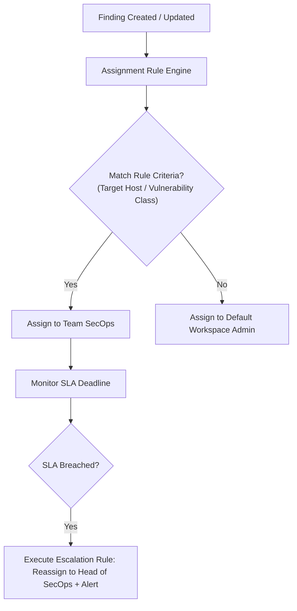

# P4-24 — Implement Enterprise Assignment and Escalation Rules

**Parent Epic:** [Phase 4 — Enterprise Platform, Security & Scalability](../MILESTONE_PHASE_4.md)  
**Milestone:** [Phase 4 — Enterprise Platform, Security & Scalability](../MILESTONE_PHASE_4.md)  
**Workstream:** Workstream C — Policy & Workflow Governance  
**Status:** `ready-for-dev`  

---

## 🎯 Purpose

Extend Phase 3's basic remediation assignment into configurable organization-level assignment and escalation.

---

## 📐 Architecture & Workflow Diagram

---

## 📋 Detailed Requirements

- Support rules based on workspace, team, finding classification, and priority.
- Define default assignment behavior.
- Support escalation when deadlines are missed.
- Define authorized fallback owners.
- Ensure assignments resolve only to active users or teams within the approved organization.
- Prevent recursive or circular escalation rules.
- Record rule version and execution outcome.
- Allow manual override only for authorized users.
- Defer external ticketing synchronization to the integration workstream.

---

## 🛡️ Security & Architectural Invariants

- **Enterprise Multi-Tenancy:** Multi-organization and workspace hierarchy must never bypass or compromise the core tenant isolation boundaries established in ADR-0002.
- **Principle of Least Privilege:** RBAC/ABAC policy engines and service identity delegation must deny access by default and explicitly enforce permission scopes.
- **Tamper-Evident Auditability:** All administrative actions, SSO events, policy alterations, secret accesses, and integration invocations must emit structured, immutable audit log events.
- **Fail-Safe Operation:** Quotas, rate limits, distributed queue failovers, and webhook dispatchers must degrade gracefully without data loss, deadlocks, or silent failures.

---

## ✅ Acceptance Criteria

- [ ] Assignment rules are evaluated consistently.
- [ ] Escalation follows documented conditions.
- [ ] Unauthorized or inactive owners are rejected.
- [ ] Circular rules are detected or prevented.
- [ ] Assignment and escalation events are audited.

---

## 🔗 Related Documentation & Links

- Enterprise Architecture Baseline: [`docs/architecture/SYSTEM_ARCHITECTURE.md`](../../../docs/architecture/SYSTEM_ARCHITECTURE.md)
- Multi-Tenancy & Isolation Model: [`docs/architecture/TENANT_ISOLATION.md`](../../../docs/architecture/TENANT_ISOLATION.md)
- Security Policies & Auditing: [`docs/security/AUDIT_SPECIFICATION.md`](../../../docs/security/AUDIT_SPECIFICATION.md)
- API & Webhook Specifications: [`docs/api/API_SPECIFICATION.md`](../../../docs/api/API_SPECIFICATION.md)
