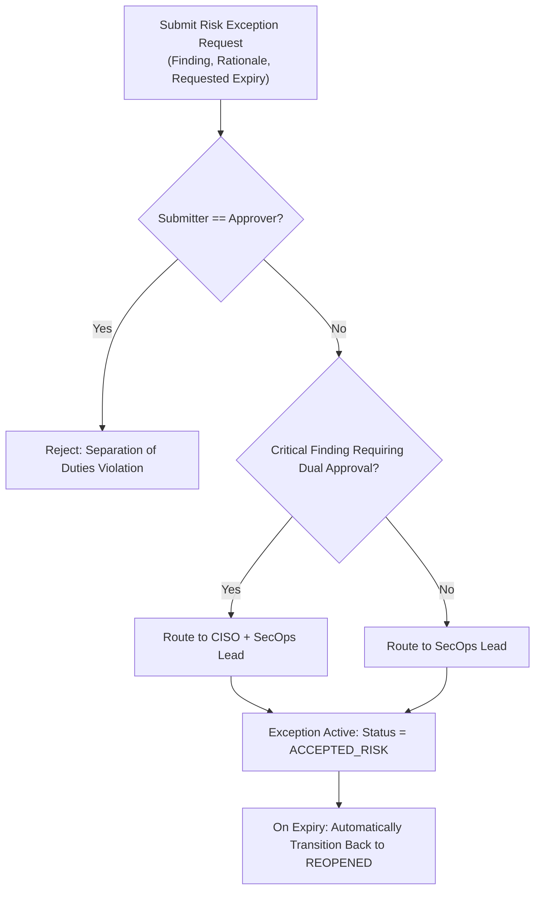

# P4-25 — Implement Accepted-Risk Approval and Exception Governance

**Parent Epic:** [Phase 4 — Enterprise Platform, Security & Scalability](../MILESTONE_PHASE_4.md)  
**Milestone:** [Phase 4 — Enterprise Platform, Security & Scalability](../MILESTONE_PHASE_4.md)  
**Workstream:** Workstream C — Policy & Workflow Governance  
**Status:** `ready-for-dev`  

---

## 🎯 Purpose

Introduce a formal approval process for accepting security risks or granting time-bound exceptions.

---

## 📐 Architecture & Workflow Diagram

---

## 📋 Detailed Requirements

- Define exception categories and supported scope.
- Support justification and business rationale.
- Require approval from authorized roles (e.g. CISO / Security Lead).
- Support expiration dates and review dates (max 90 days).
- Define whether high-risk exceptions require multiple approvers (dual authorization).
- Prevent users from approving their own requests (Separation of Duties).
- Link decisions to affected findings and targets.
- Define behavior when an exception expires.
- Ensure accepted-risk status does not delete evidence or remove the finding from history.
- Record the complete approval chain.

---

## 🛡️ Security & Architectural Invariants

- **Enterprise Multi-Tenancy:** Multi-organization and workspace hierarchy must never bypass or compromise the core tenant isolation boundaries established in ADR-0002.
- **Principle of Least Privilege:** RBAC/ABAC policy engines and service identity delegation must deny access by default and explicitly enforce permission scopes.
- **Tamper-Evident Auditability:** All administrative actions, SSO events, policy alterations, secret accesses, and integration invocations must emit structured, immutable audit log events.
- **Fail-Safe Operation:** Quotas, rate limits, distributed queue failovers, and webhook dispatchers must degrade gracefully without data loss, deadlocks, or silent failures.

---

## ✅ Acceptance Criteria

- [ ] Risk exceptions have a defined approval workflow.
- [ ] Approval permissions are enforced.
- [ ] Expiry and review dates are applied.
- [ ] Separation-of-duties requirements are enforced where configured.
- [ ] Complete approval history is retained.

---

## 🔗 Related Documentation & Links

- Enterprise Architecture Baseline: [`docs/architecture/SYSTEM_ARCHITECTURE.md`](../../../docs/architecture/SYSTEM_ARCHITECTURE.md)
- Multi-Tenancy & Isolation Model: [`docs/architecture/TENANT_ISOLATION.md`](../../../docs/architecture/TENANT_ISOLATION.md)
- Security Policies & Auditing: [`docs/security/AUDIT_SPECIFICATION.md`](../../../docs/security/AUDIT_SPECIFICATION.md)
- API & Webhook Specifications: [`docs/api/API_SPECIFICATION.md`](../../../docs/api/API_SPECIFICATION.md)
