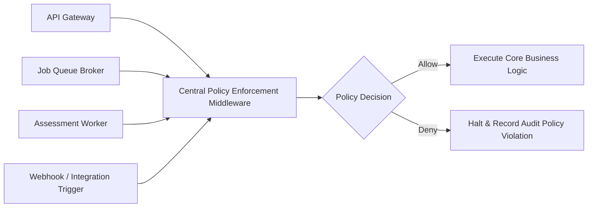

# P4-26 — Implement Central Policy Enforcement Across Application Boundaries

**Parent Epic:** [Phase 4 — Enterprise Platform, Security & Scalability](../MILESTONE_PHASE_4.md)  
**Milestone:** [Phase 4 — Enterprise Platform, Security & Scalability](../MILESTONE_PHASE_4.md)  
**Workstream:** Workstream C — Policy & Workflow Governance  
**Status:** `ready-for-dev`  

---

## 🎯 Purpose

Ensure the enterprise policy engine is enforced consistently rather than being limited to individual application screens.

---

## 📐 Architecture & Workflow Diagram

---

## 📋 Detailed Requirements

- Integrate policy evaluation with: Assessment creation, Assessment scheduling, Worker execution authorization, Scan profile selection, Finding triage, Remediation workflows, Exception approval, Integration-triggered operations.
- Define which policies are checked synchronously and which are evaluated asynchronously.
- Prevent queued work from bypassing updated policy requirements.
- Define whether an in-progress job continues, pauses, or terminates after a policy change.
- Preserve the policy decision and version for relevant operations.
- Avoid duplicated or conflicting policy enforcement implementations.
- Ensure platform security restrictions remain non-overridable.

---

## 🛡️ Security & Architectural Invariants

- **Enterprise Multi-Tenancy:** Multi-organization and workspace hierarchy must never bypass or compromise the core tenant isolation boundaries established in ADR-0002.
- **Principle of Least Privilege:** RBAC/ABAC policy engines and service identity delegation must deny access by default and explicitly enforce permission scopes.
- **Tamper-Evident Auditability:** All administrative actions, SSO events, policy alterations, secret accesses, and integration invocations must emit structured, immutable audit log events.
- **Fail-Safe Operation:** Quotas, rate limits, distributed queue failovers, and webhook dispatchers must degrade gracefully without data loss, deadlocks, or silent failures.

---

## ✅ Acceptance Criteria

- [ ] Required enforcement points are integrated.
- [ ] UI, API, worker, and integration paths follow consistent policy rules.
- [ ] Policy changes affect queued work according to documented semantics.
- [ ] Decisions are traceable.
- [ ] Integration tests verify enforcement across application boundaries.

---

## 🔗 Related Documentation & Links

- Enterprise Architecture Baseline: [`docs/architecture/SYSTEM_ARCHITECTURE.md`](../../../docs/architecture/SYSTEM_ARCHITECTURE.md)
- Multi-Tenancy & Isolation Model: [`docs/architecture/TENANT_ISOLATION.md`](../../../docs/architecture/TENANT_ISOLATION.md)
- Security Policies & Auditing: [`docs/security/AUDIT_SPECIFICATION.md`](../../../docs/security/AUDIT_SPECIFICATION.md)
- API & Webhook Specifications: [`docs/api/API_SPECIFICATION.md`](../../../docs/api/API_SPECIFICATION.md)
