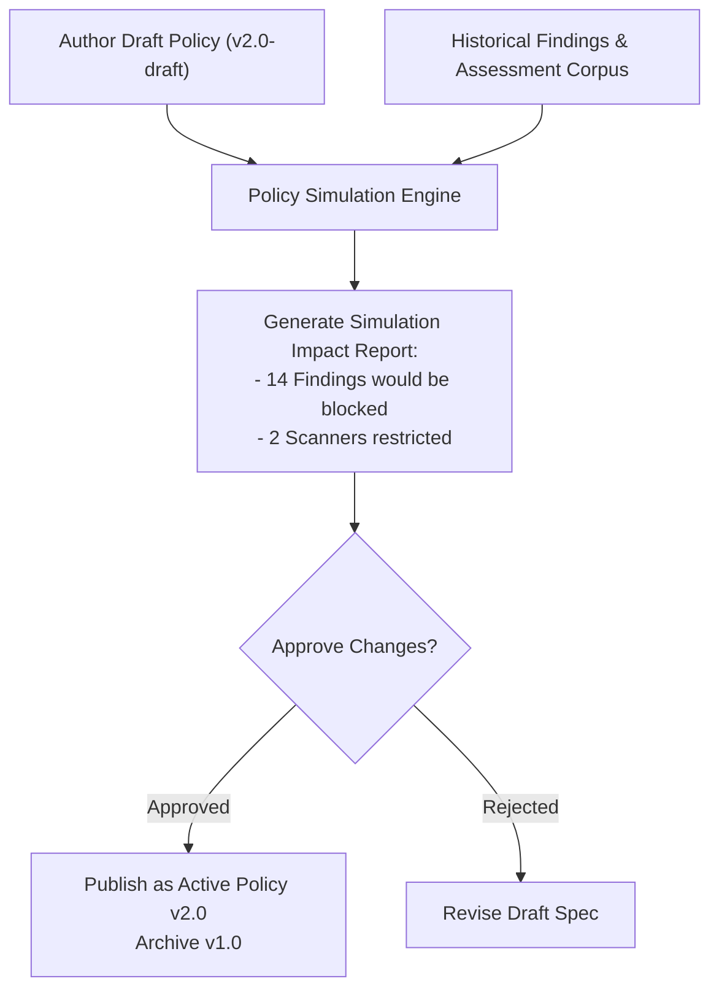

# P4-27 — Implement Policy Versioning, Simulation and Change Audit

**Parent Epic:** [Phase 4 — Enterprise Platform, Security & Scalability](../MILESTONE_PHASE_4.md)  
**Milestone:** [Phase 4 — Enterprise Platform, Security & Scalability](../MILESTONE_PHASE_4.md)  
**Workstream:** Workstream C — Policy & Workflow Governance  
**Status:** `ready-for-dev`  

---

## 🎯 Purpose

Allow administrators to evolve organization policies safely without silently altering the behavior of existing assessments and workflows.

---

## 📐 Architecture & Workflow Diagram

---

## 📋 Detailed Requirements

- Version policy definitions.
- Preserve historical versions and authorship.
- Support draft and published policy states.
- Provide a simulation or dry-run mode for supported policy changes.
- Show which operations or resources would be affected.
- Detect incompatible or contradictory rules where possible.
- Require authorization for publication.
- Define rollback to a previous approved version.
- Record policy evaluation outcomes and relevant policy references.
- Avoid executing real scanner operations during policy simulation.

---

## 🛡️ Security & Architectural Invariants

- **Enterprise Multi-Tenancy:** Multi-organization and workspace hierarchy must never bypass or compromise the core tenant isolation boundaries established in ADR-0002.
- **Principle of Least Privilege:** RBAC/ABAC policy engines and service identity delegation must deny access by default and explicitly enforce permission scopes.
- **Tamper-Evident Auditability:** All administrative actions, SSO events, policy alterations, secret accesses, and integration invocations must emit structured, immutable audit log events.
- **Fail-Safe Operation:** Quotas, rate limits, distributed queue failovers, and webhook dispatchers must degrade gracefully without data loss, deadlocks, or silent failures.

---

## ✅ Acceptance Criteria

- [ ] Policy versions are preserved.
- [ ] Draft policies can be simulated without enforcement side effects.
- [ ] Publication requires appropriate permissions.
- [ ] Rollback is controlled and auditable.
- [ ] Historical decisions retain their original policy references.

---

## 🔗 Related Documentation & Links

- Enterprise Architecture Baseline: [`docs/architecture/SYSTEM_ARCHITECTURE.md`](../../../docs/architecture/SYSTEM_ARCHITECTURE.md)
- Multi-Tenancy & Isolation Model: [`docs/architecture/TENANT_ISOLATION.md`](../../../docs/architecture/TENANT_ISOLATION.md)
- Security Policies & Auditing: [`docs/security/AUDIT_SPECIFICATION.md`](../../../docs/security/AUDIT_SPECIFICATION.md)
- API & Webhook Specifications: [`docs/api/API_SPECIFICATION.md`](../../../docs/api/API_SPECIFICATION.md)
