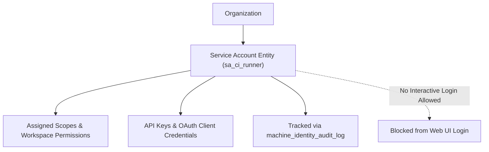

# P4-28 — Define the Machine Identity and Service Account Model

**Parent Epic:** [Phase 4 — Enterprise Platform, Security & Scalability](../MILESTONE_PHASE_4.md)  
**Milestone:** [Phase 4 — Enterprise Platform, Security & Scalability](../MILESTONE_PHASE_4.md)  
**Workstream:** Workstream D — API Identities, Integrations & Notifications  
**Status:** `ready-for-dev`  

---

## 🎯 Purpose

Introduce identities for automated systems that interact with KELVIN independently of human user sessions.

---

## 📐 Architecture & Workflow Diagram

---

## 📋 Detailed Requirements

- Define service accounts separately from human users.
- Define ownership by organization and permitted workspace.
- Support role and permission assignment using the approved authorization model.
- Define service account states and lifecycle.
- Support credential rotation and revocation.
- Avoid interactive login behavior for machine identities.
- Require explicit administrative creation and approval.
- Record creator, owner, permissions, and last-use metadata.
- Define what happens to integrations when a service account is suspended.

---

## 🛡️ Security & Architectural Invariants

- **Enterprise Multi-Tenancy:** Multi-organization and workspace hierarchy must never bypass or compromise the core tenant isolation boundaries established in ADR-0002.
- **Principle of Least Privilege:** RBAC/ABAC policy engines and service identity delegation must deny access by default and explicitly enforce permission scopes.
- **Tamper-Evident Auditability:** All administrative actions, SSO events, policy alterations, secret accesses, and integration invocations must emit structured, immutable audit log events.
- **Fail-Safe Operation:** Quotas, rate limits, distributed queue failovers, and webhook dispatchers must degrade gracefully without data loss, deadlocks, or silent failures.

---

## ✅ Acceptance Criteria

- [ ] Machine identities have a distinct domain model.
- [ ] Human-user session assumptions are not reused.
- [ ] Service accounts have explicit ownership and permissions.
- [ ] Lifecycle changes invalidate applicable access.
- [ ] Service account operations are audited.

---

## 🔗 Related Documentation & Links

- Enterprise Architecture Baseline: [`docs/architecture/SYSTEM_ARCHITECTURE.md`](../../../docs/architecture/SYSTEM_ARCHITECTURE.md)
- Multi-Tenancy & Isolation Model: [`docs/architecture/TENANT_ISOLATION.md`](../../../docs/architecture/TENANT_ISOLATION.md)
- Security Policies & Auditing: [`docs/security/AUDIT_SPECIFICATION.md`](../../../docs/security/AUDIT_SPECIFICATION.md)
- API & Webhook Specifications: [`docs/api/API_SPECIFICATION.md`](../../../docs/api/API_SPECIFICATION.md)
