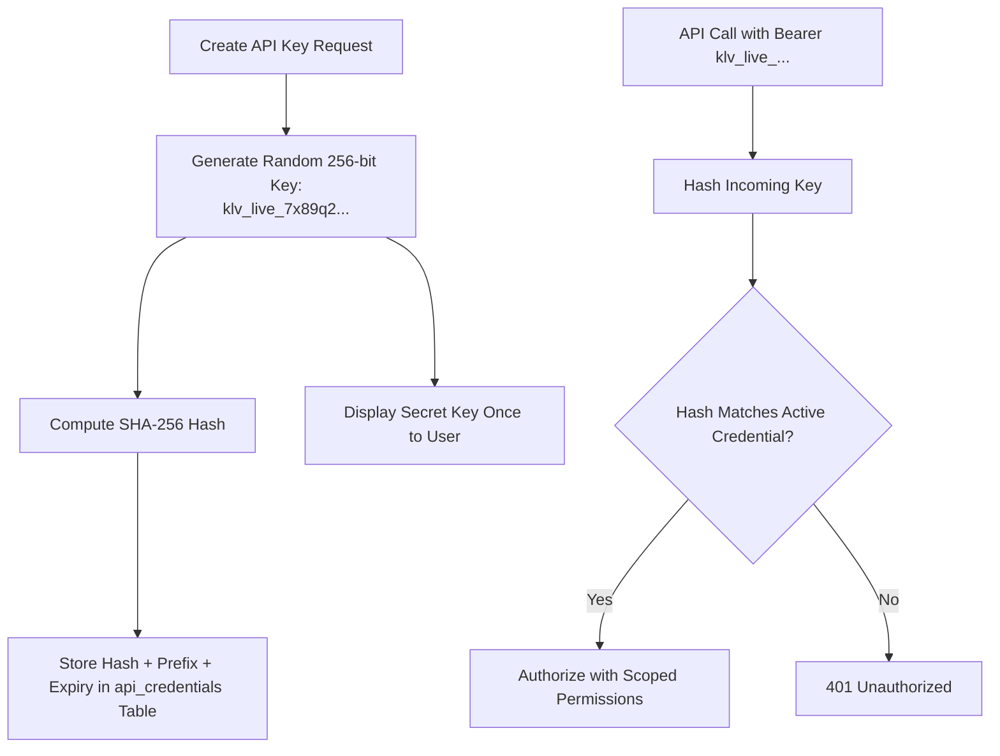

# P4-29 — Implement API Credential and Key Lifecycle Management

**Parent Epic:** [Phase 4 — Enterprise Platform, Security & Scalability](../MILESTONE_PHASE_4.md)  
**Milestone:** [Phase 4 — Enterprise Platform, Security & Scalability](../MILESTONE_PHASE_4.md)  
**Workstream:** Workstream D — API Identities, Integrations & Notifications  
**Status:** `ready-for-dev`  

---

## 🎯 Purpose

Provide secure creation, storage, display, rotation, expiration, and revocation of API credentials.

---

## 📐 Architecture & Workflow Diagram

---

## 📋 Detailed Requirements

- Support scoped API credentials tied to service identities.
- Generate cryptographically secure credential material (e.g. klv_live_...).
- Display secret material only once at creation time.
- Store only one-way cryptographic hashes (SHA-256) of API keys.
- Support explicit permission and workspace scope.
- Support expiry (e.g. 90d default) and rotation.
- Support immediate revocation.
- Prevent credentials from appearing in logs, URLs, or error responses.
- Provide last-used metadata without logging secret values.
- Define behavior for leaked or compromised credentials.
- Avoid treating an API key as a replacement for the underlying service identity.

---

## 🛡️ Security & Architectural Invariants

- **Enterprise Multi-Tenancy:** Multi-organization and workspace hierarchy must never bypass or compromise the core tenant isolation boundaries established in ADR-0002.
- **Principle of Least Privilege:** RBAC/ABAC policy engines and service identity delegation must deny access by default and explicitly enforce permission scopes.
- **Tamper-Evident Auditability:** All administrative actions, SSO events, policy alterations, secret accesses, and integration invocations must emit structured, immutable audit log events.
- **Fail-Safe Operation:** Quotas, rate limits, distributed queue failovers, and webhook dispatchers must degrade gracefully without data loss, deadlocks, or silent failures.

---

## ✅ Acceptance Criteria

- [ ] API credentials are scoped and revocable.
- [ ] Secret material is not retrievable after its approved creation-time display.
- [ ] Credential expiry and rotation work.
- [ ] Revoked credentials cannot authorize further requests.
- [ ] Leakage-prevention tests pass.

---

## 🔗 Related Documentation & Links

- Enterprise Architecture Baseline: [`docs/architecture/SYSTEM_ARCHITECTURE.md`](../../../docs/architecture/SYSTEM_ARCHITECTURE.md)
- Multi-Tenancy & Isolation Model: [`docs/architecture/TENANT_ISOLATION.md`](../../../docs/architecture/TENANT_ISOLATION.md)
- Security Policies & Auditing: [`docs/security/AUDIT_SPECIFICATION.md`](../../../docs/security/AUDIT_SPECIFICATION.md)
- API & Webhook Specifications: [`docs/api/API_SPECIFICATION.md`](../../../docs/api/API_SPECIFICATION.md)
