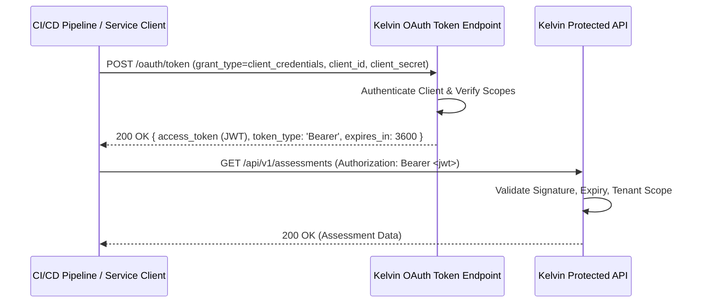

# P4-30 — Implement OAuth 2.0 Client Credentials for Machine-to-Machine Access

**Parent Epic:** [Phase 4 — Enterprise Platform, Security & Scalability](../MILESTONE_PHASE_4.md)  
**Milestone:** [Phase 4 — Enterprise Platform, Security & Scalability](../MILESTONE_PHASE_4.md)  
**Workstream:** Workstream D — API Identities, Integrations & Notifications  
**Status:** `ready-for-dev`  

---

## 🎯 Purpose

Support standards-based machine-to-machine authentication for authorized integrations and enterprise automation.

---

## 📐 Architecture & Workflow Diagram

---

## 📋 Detailed Requirements

- Define the supported OAuth 2.0 client credentials profile (RFC 6749).
- Associate clients with registered service identities.
- Issue access tokens with limited scopes and bounded lifetime (1 hour).
- Validate client authentication and token requests.
- Prevent client-credential scope escalation.
- Define token revocation or short-lived token invalidation behavior.
- Prevent credentials from being exposed in logs or URLs.
- Define rotation and deactivation behavior.
- Keep user-delegated authorization flows outside this issue unless explicitly required by an approved future design.

---

## 🛡️ Security & Architectural Invariants

- **Enterprise Multi-Tenancy:** Multi-organization and workspace hierarchy must never bypass or compromise the core tenant isolation boundaries established in ADR-0002.
- **Principle of Least Privilege:** RBAC/ABAC policy engines and service identity delegation must deny access by default and explicitly enforce permission scopes.
- **Tamper-Evident Auditability:** All administrative actions, SSO events, policy alterations, secret accesses, and integration invocations must emit structured, immutable audit log events.
- **Fail-Safe Operation:** Quotas, rate limits, distributed queue failovers, and webhook dispatchers must degrade gracefully without data loss, deadlocks, or silent failures.

---

## ✅ Acceptance Criteria

- [ ] Registered service identities can obtain scoped access tokens.
- [ ] Token validity and scope are enforced.
- [ ] Token lifetime is bounded.
- [ ] Client credentials cannot grant permissions beyond the service identity.
- [ ] Negative tests cover invalid clients and scope escalation.

---

## 🔗 Related Documentation & Links

- Enterprise Architecture Baseline: [`docs/architecture/SYSTEM_ARCHITECTURE.md`](../../../docs/architecture/SYSTEM_ARCHITECTURE.md)
- Multi-Tenancy & Isolation Model: [`docs/architecture/TENANT_ISOLATION.md`](../../../docs/architecture/TENANT_ISOLATION.md)
- Security Policies & Auditing: [`docs/security/AUDIT_SPECIFICATION.md`](../../../docs/security/AUDIT_SPECIFICATION.md)
- API & Webhook Specifications: [`docs/api/API_SPECIFICATION.md`](../../../docs/api/API_SPECIFICATION.md)
