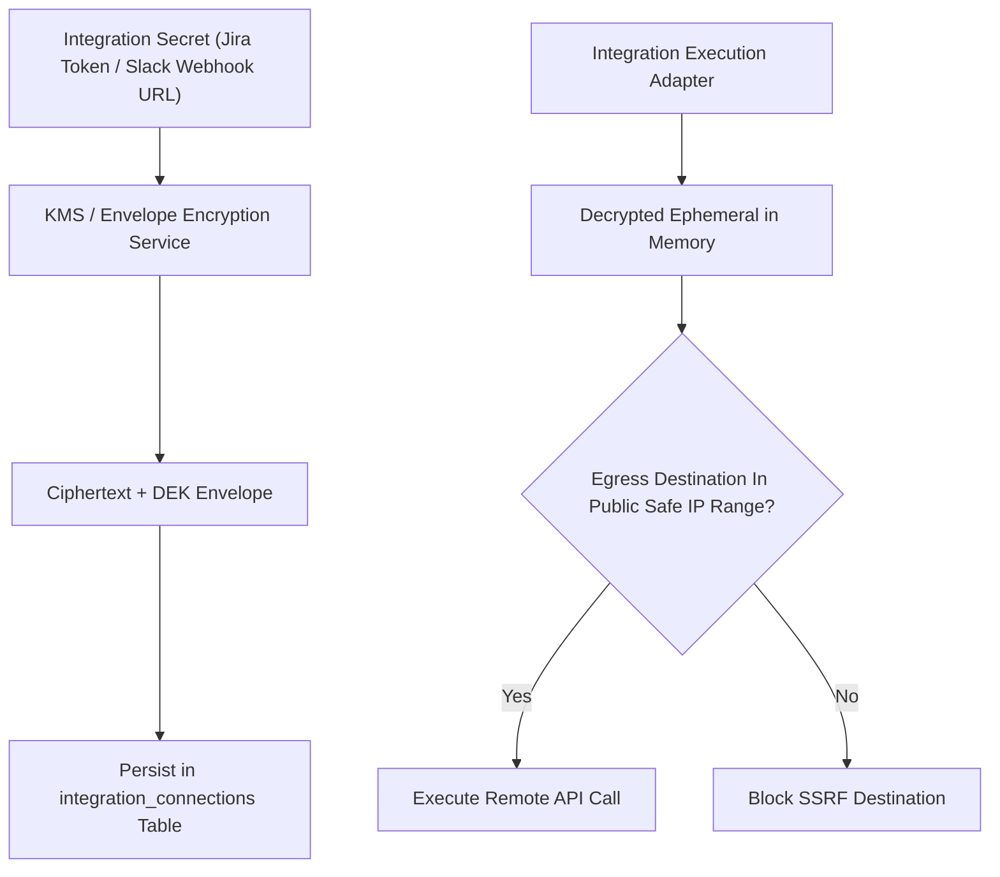

# P4-31 — Implement Secure Integration Connection and Secret Management

**Parent Epic:** [Phase 4 — Enterprise Platform, Security & Scalability](../MILESTONE_PHASE_4.md)  
**Milestone:** [Phase 4 — Enterprise Platform, Security & Scalability](../MILESTONE_PHASE_4.md)  
**Workstream:** Workstream D — API Identities, Integrations & Notifications  
**Status:** `ready-for-dev`  

---

## 🎯 Purpose

Create a consistent mechanism for storing and managing credentials used by external integrations.

---

## 📐 Architecture & Workflow Diagram

---

## 📋 Detailed Requirements

- Define the integration connection domain model.
- Associate each connection with an organization and owner.
- Store credentials using the approved secrets-management abstraction.
- Avoid storing plaintext integration secrets in ordinary application tables.
- Define credential encryption (Envelope Encryption AES-GCM-256), access, rotation, and deletion policies.
- Validate integration endpoints and configuration.
- Protect against SSRF and unsafe callback destinations.
- Restrict access to integration credentials to the relevant adapter.
- Redact all secrets from logs and diagnostics.
- Record credential lifecycle and connection changes.

---

## 🛡️ Security & Architectural Invariants

- **Enterprise Multi-Tenancy:** Multi-organization and workspace hierarchy must never bypass or compromise the core tenant isolation boundaries established in ADR-0002.
- **Principle of Least Privilege:** RBAC/ABAC policy engines and service identity delegation must deny access by default and explicitly enforce permission scopes.
- **Tamper-Evident Auditability:** All administrative actions, SSO events, policy alterations, secret accesses, and integration invocations must emit structured, immutable audit log events.
- **Fail-Safe Operation:** Quotas, rate limits, distributed queue failovers, and webhook dispatchers must degrade gracefully without data loss, deadlocks, or silent failures.

---

## ✅ Acceptance Criteria

- [ ] Integration secrets use a controlled secrets-management mechanism.
- [ ] Credentials are not exposed through ordinary APIs.
- [ ] Connections are tenant-scoped.
- [ ] Endpoint validation and SSRF protections are applied.
- [ ] Secret changes are auditable without recording secret values.

---

## 🔗 Related Documentation & Links

- Enterprise Architecture Baseline: [`docs/architecture/SYSTEM_ARCHITECTURE.md`](../../../docs/architecture/SYSTEM_ARCHITECTURE.md)
- Multi-Tenancy & Isolation Model: [`docs/architecture/TENANT_ISOLATION.md`](../../../docs/architecture/TENANT_ISOLATION.md)
- Security Policies & Auditing: [`docs/security/AUDIT_SPECIFICATION.md`](../../../docs/security/AUDIT_SPECIFICATION.md)
- API & Webhook Specifications: [`docs/api/API_SPECIFICATION.md`](../../../docs/api/API_SPECIFICATION.md)
