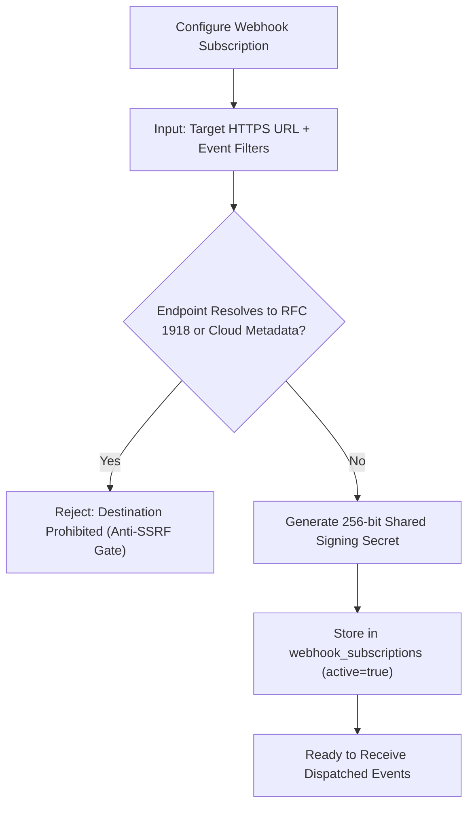

# P4-32 — Implement Outbound Webhook Subscription Management

**Parent Epic:** [Phase 4 — Enterprise Platform, Security & Scalability](../MILESTONE_PHASE_4.md)  
**Milestone:** [Phase 4 — Enterprise Platform, Security & Scalability](../MILESTONE_PHASE_4.md)  
**Workstream:** Workstream D — API Identities, Integrations & Notifications  
**Status:** `ready-for-dev`  

---

## 🎯 Purpose

Allow organizations to subscribe external systems to selected KELVIN events.

---

## 📐 Architecture & Workflow Diagram

---

## 📋 Detailed Requirements

- Define a versioned webhook event catalog.
- Support subscriptions for approved events: Assessment completed/failed, Finding created/status changed, Risk exception approved/expired, Remediation state changed, Report generated.
- Allow authorized users to configure endpoint and event selection.
- Validate endpoint schemes (HTTPS only) and destination restrictions.
- Prevent subscriptions to prohibited internal, loopback, or metadata-service destinations (Anti-SSRF).
- Define secret management for webhook signing (shared secret generation).
- Support subscription enable, disable, rotation, and deletion.
- Avoid including unnecessary sensitive evidence or credentials in payloads.

---

## 🛡️ Security & Architectural Invariants

- **Enterprise Multi-Tenancy:** Multi-organization and workspace hierarchy must never bypass or compromise the core tenant isolation boundaries established in ADR-0002.
- **Principle of Least Privilege:** RBAC/ABAC policy engines and service identity delegation must deny access by default and explicitly enforce permission scopes.
- **Tamper-Evident Auditability:** All administrative actions, SSO events, policy alterations, secret accesses, and integration invocations must emit structured, immutable audit log events.
- **Fail-Safe Operation:** Quotas, rate limits, distributed queue failovers, and webhook dispatchers must degrade gracefully without data loss, deadlocks, or silent failures.

---

## ✅ Acceptance Criteria

- [ ] Authorized organizations can configure subscriptions.
- [ ] Only documented event types can be selected.
- [ ] Destination validation is enforced.
- [ ] Webhook secrets are protected.
- [ ] Subscription lifecycle is auditable.

---

## 🔗 Related Documentation & Links

- Enterprise Architecture Baseline: [`docs/architecture/SYSTEM_ARCHITECTURE.md`](../../../docs/architecture/SYSTEM_ARCHITECTURE.md)
- Multi-Tenancy & Isolation Model: [`docs/architecture/TENANT_ISOLATION.md`](../../../docs/architecture/TENANT_ISOLATION.md)
- Security Policies & Auditing: [`docs/security/AUDIT_SPECIFICATION.md`](../../../docs/security/AUDIT_SPECIFICATION.md)
- API & Webhook Specifications: [`docs/api/API_SPECIFICATION.md`](../../../docs/api/API_SPECIFICATION.md)
