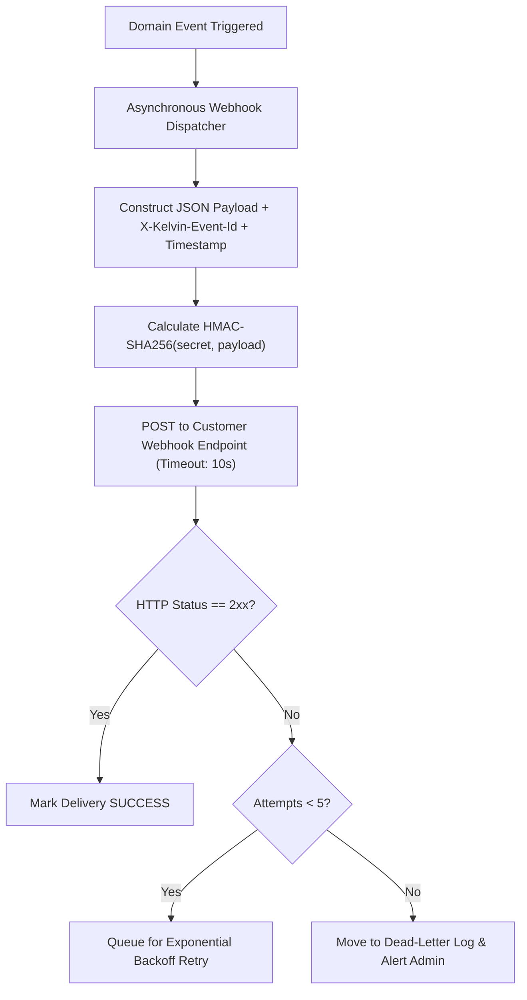

# P4-33 — Implement Signed Webhook Delivery, Retry and Replay Protection

**Parent Epic:** [Phase 4 — Enterprise Platform, Security & Scalability](../MILESTONE_PHASE_4.md)  
**Milestone:** [Phase 4 — Enterprise Platform, Security & Scalability](../MILESTONE_PHASE_4.md)  
**Workstream:** Workstream D — API Identities, Integrations & Notifications  
**Status:** `ready-for-dev`  

---

## 🎯 Purpose

Deliver outbound events reliably while allowing receiving systems to verify authenticity and detect repeated deliveries.

---

## 📐 Architecture & Workflow Diagram

---

## 📋 Detailed Requirements

- Sign outbound payloads using HMAC-SHA256 (X-Kelvin-Signature header).
- Include timestamp (X-Kelvin-Timestamp) and unique event identifier (X-Kelvin-Event-Id).
- Document signature verification for consumers.
- Use bounded delivery retries and exponential backoff (Max 5 attempts).
- Persist delivery status and attempt metadata.
- Define idempotency semantics for event delivery.
- Support controlled redelivery by authorized administrators.
- Prevent replay from being mistaken for a new event.
- Enforce request timeouts (10s) and response-size limits (64KB).
- Isolate slow or failing webhook destinations from core application requests.
- Define event delivery retention and cleanup.

---

## 🛡️ Security & Architectural Invariants

- **Enterprise Multi-Tenancy:** Multi-organization and workspace hierarchy must never bypass or compromise the core tenant isolation boundaries established in ADR-0002.
- **Principle of Least Privilege:** RBAC/ABAC policy engines and service identity delegation must deny access by default and explicitly enforce permission scopes.
- **Tamper-Evident Auditability:** All administrative actions, SSO events, policy alterations, secret accesses, and integration invocations must emit structured, immutable audit log events.
- **Fail-Safe Operation:** Quotas, rate limits, distributed queue failovers, and webhook dispatchers must degrade gracefully without data loss, deadlocks, or silent failures.

---

## ✅ Acceptance Criteria

- [ ] Payload signatures can be verified.
- [ ] Event IDs and timestamps are included.
- [ ] Delivery retries are bounded.
- [ ] Duplicate delivery can be identified.
- [ ] Failed destinations do not block core assessment operations.
- [ ] Delivery behavior is observable and tested.

---

## 🔗 Related Documentation & Links

- Enterprise Architecture Baseline: [`docs/architecture/SYSTEM_ARCHITECTURE.md`](../../../docs/architecture/SYSTEM_ARCHITECTURE.md)
- Multi-Tenancy & Isolation Model: [`docs/architecture/TENANT_ISOLATION.md`](../../../docs/architecture/TENANT_ISOLATION.md)
- Security Policies & Auditing: [`docs/security/AUDIT_SPECIFICATION.md`](../../../docs/security/AUDIT_SPECIFICATION.md)
- API & Webhook Specifications: [`docs/api/API_SPECIFICATION.md`](../../../docs/api/API_SPECIFICATION.md)
