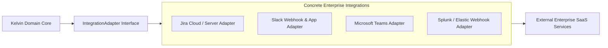

# P4-34 — Define the External Integration Adapter Framework

**Parent Epic:** [Phase 4 — Enterprise Platform, Security & Scalability](../MILESTONE_PHASE_4.md)  
**Milestone:** [Phase 4 — Enterprise Platform, Security & Scalability](../MILESTONE_PHASE_4.md)  
**Workstream:** Workstream D — API Identities, Integrations & Notifications  
**Status:** `ready-for-dev`  

---

## 🎯 Purpose

Provide a reusable architecture for connecting KELVIN to external ticketing, collaboration, identity, and security systems.

---

## 📐 Architecture & Workflow Diagram

---

## 📋 Detailed Requirements

- Define a common integration contract (IntegrationAdapter interface).
- Support connection validation, capability discovery, authorization, execution, and health checks.
- Isolate provider-specific logic from domain and application services.
- Define integration event and data mapping contracts.
- Support asynchronous operations where necessary.
- Define rate limits and provider error semantics.
- Ensure integrations cannot bypass tenant or resource authorization.
- Define versioning for adapters and their configuration schemas.
- Provide fake providers for deterministic tests.

---

## 🛡️ Security & Architectural Invariants

- **Enterprise Multi-Tenancy:** Multi-organization and workspace hierarchy must never bypass or compromise the core tenant isolation boundaries established in ADR-0002.
- **Principle of Least Privilege:** RBAC/ABAC policy engines and service identity delegation must deny access by default and explicitly enforce permission scopes.
- **Tamper-Evident Auditability:** All administrative actions, SSO events, policy alterations, secret accesses, and integration invocations must emit structured, immutable audit log events.
- **Fail-Safe Operation:** Quotas, rate limits, distributed queue failovers, and webhook dispatchers must degrade gracefully without data loss, deadlocks, or silent failures.

---

## ✅ Acceptance Criteria

- [ ] A documented integration adapter contract exists.
- [ ] Provider-specific implementations remain isolated.
- [ ] Connection health and errors are represented consistently.
- [ ] Tenant and permission context is preserved.
- [ ] A reference adapter passes conformance tests.

---

## 🔗 Related Documentation & Links

- Enterprise Architecture Baseline: [`docs/architecture/SYSTEM_ARCHITECTURE.md`](../../../docs/architecture/SYSTEM_ARCHITECTURE.md)
- Multi-Tenancy & Isolation Model: [`docs/architecture/TENANT_ISOLATION.md`](../../../docs/architecture/TENANT_ISOLATION.md)
- Security Policies & Auditing: [`docs/security/AUDIT_SPECIFICATION.md`](../../../docs/security/AUDIT_SPECIFICATION.md)
- API & Webhook Specifications: [`docs/api/API_SPECIFICATION.md`](../../../docs/api/API_SPECIFICATION.md)
