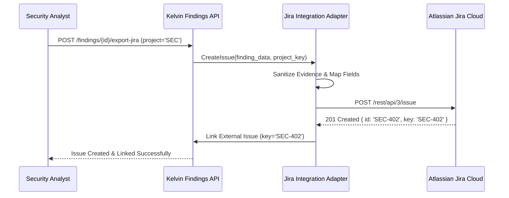

# P4-35 — Implement Jira Issue-Tracking Integration

**Parent Epic:** [Phase 4 — Enterprise Platform, Security & Scalability](../MILESTONE_PHASE_4.md)  
**Milestone:** [Phase 4 — Enterprise Platform, Security & Scalability](../MILESTONE_PHASE_4.md)  
**Workstream:** Workstream D — API Identities, Integrations & Notifications  
**Status:** `ready-for-dev`  

---

## 🎯 Purpose

Allow organizations to create and reference Jira issues from KELVIN findings and remediation workflows.

---

## 📐 Architecture & Workflow Diagram

---

## 📋 Detailed Requirements

- Implement an adapter for Jira Cloud and Data Center REST API.
- Support secure connection configuration with encrypted API tokens.
- Validate the required project and issue permissions.
- Allow authorized users to create an issue from a finding or remediation record.
- Map selected finding fields to configured Jira fields (Title, Summary, Severity to Priority).
- Store the external issue reference in KELVIN (external_issue_key, url).
- Define whether synchronization is one-way or supports selected bidirectional fields.
- Prevent sensitive evidence from being copied into Jira without an explicit approved mapping.
- Handle API failures, rate limits, permission errors, and expired credentials.
- Prevent duplicate issue creation through idempotency controls.
- Record synchronization outcomes.

---

## 🛡️ Security & Architectural Invariants

- **Enterprise Multi-Tenancy:** Multi-organization and workspace hierarchy must never bypass or compromise the core tenant isolation boundaries established in ADR-0002.
- **Principle of Least Privilege:** RBAC/ABAC policy engines and service identity delegation must deny access by default and explicitly enforce permission scopes.
- **Tamper-Evident Auditability:** All administrative actions, SSO events, policy alterations, secret accesses, and integration invocations must emit structured, immutable audit log events.
- **Fail-Safe Operation:** Quotas, rate limits, distributed queue failovers, and webhook dispatchers must degrade gracefully without data loss, deadlocks, or silent failures.

---

## ✅ Acceptance Criteria

- [ ] Authorized users can create an external issue from a permitted finding.
- [ ] Jira credentials are protected.
- [ ] Duplicate issue creation is prevented where the operation is retried.
- [ ] Mapped fields are validated.
- [ ] Synchronization errors are traceable.
- [ ] Integration tests use a mock provider or approved test environment.

---

## 🔗 Related Documentation & Links

- Enterprise Architecture Baseline: [`docs/architecture/SYSTEM_ARCHITECTURE.md`](../../../docs/architecture/SYSTEM_ARCHITECTURE.md)
- Multi-Tenancy & Isolation Model: [`docs/architecture/TENANT_ISOLATION.md`](../../../docs/architecture/TENANT_ISOLATION.md)
- Security Policies & Auditing: [`docs/security/AUDIT_SPECIFICATION.md`](../../../docs/security/AUDIT_SPECIFICATION.md)
- API & Webhook Specifications: [`docs/api/API_SPECIFICATION.md`](../../../docs/api/API_SPECIFICATION.md)
