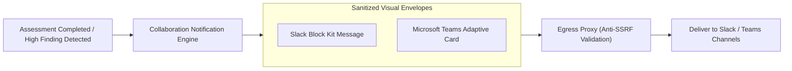

# P4-36 — Implement Collaboration Platform Notifications Integration

**Parent Epic:** [Phase 4 — Enterprise Platform, Security & Scalability](../MILESTONE_PHASE_4.md)  
**Milestone:** [Phase 4 — Enterprise Platform, Security & Scalability](../MILESTONE_PHASE_4.md)  
**Workstream:** Workstream D — API Identities, Integrations & Notifications  
**Status:** `ready-for-dev`  

---

## 🎯 Purpose

Allow organizations to send selected KELVIN events to an approved collaboration platform.

---

## 📐 Architecture & Workflow Diagram

---

## 📋 Detailed Requirements

- Support Slack Incoming Webhooks and Microsoft Teams Connectors.
- Allow mapping of KELVIN events to specific channels.
- Restrict notifications to authorized organization channels or destinations.
- Avoid sending sensitive evidence, secrets, or excessive finding details.
- Support configurable notification templates (Slack Block Kit / MS Teams Adaptive Cards).
- Apply rate limits and delivery retry policies.
- Handle provider authentication and permission failures.
- Record delivery status.
- Allow administrators to disable or revoke a destination.

---

## 🛡️ Security & Architectural Invariants

- **Enterprise Multi-Tenancy:** Multi-organization and workspace hierarchy must never bypass or compromise the core tenant isolation boundaries established in ADR-0002.
- **Principle of Least Privilege:** RBAC/ABAC policy engines and service identity delegation must deny access by default and explicitly enforce permission scopes.
- **Tamper-Evident Auditability:** All administrative actions, SSO events, policy alterations, secret accesses, and integration invocations must emit structured, immutable audit log events.
- **Fail-Safe Operation:** Quotas, rate limits, distributed queue failovers, and webhook dispatchers must degrade gracefully without data loss, deadlocks, or silent failures.

---

## ✅ Acceptance Criteria

- [ ] Supported collaboration destinations can receive approved events.
- [ ] Destination configuration is authorized and tenant-scoped.
- [ ] Sensitive content is excluded or redacted.
- [ ] Failed notifications do not block core workflows.
- [ ] Delivery and revocation behavior is tested.

---

## 🔗 Related Documentation & Links

- Enterprise Architecture Baseline: [`docs/architecture/SYSTEM_ARCHITECTURE.md`](../../../docs/architecture/SYSTEM_ARCHITECTURE.md)
- Multi-Tenancy & Isolation Model: [`docs/architecture/TENANT_ISOLATION.md`](../../../docs/architecture/TENANT_ISOLATION.md)
- Security Policies & Auditing: [`docs/security/AUDIT_SPECIFICATION.md`](../../../docs/security/AUDIT_SPECIFICATION.md)
- API & Webhook Specifications: [`docs/api/API_SPECIFICATION.md`](../../../docs/api/API_SPECIFICATION.md)
