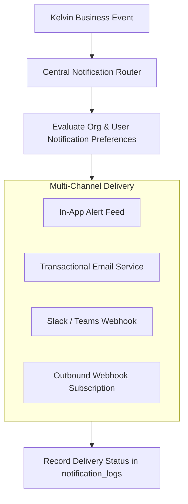

# P4-37 — Implement Central Notification Preferences and Delivery Management

**Parent Epic:** [Phase 4 — Enterprise Platform, Security & Scalability](../MILESTONE_PHASE_4.md)  
**Milestone:** [Phase 4 — Enterprise Platform, Security & Scalability](../MILESTONE_PHASE_4.md)  
**Workstream:** Workstream D — API Identities, Integrations & Notifications  
**Status:** `ready-for-dev`  

---

## 🎯 Purpose

Provide a unified notification layer for enterprise users and integrations without coupling notifications to core business operations.

---

## 📐 Architecture & Workflow Diagram

---

## 📋 Detailed Requirements

- Define notification event and delivery channel contracts.
- Support organization defaults and permitted user preferences.
- Define the relationship between in-app, email, webhook, and collaboration notifications.
- Support delivery state and retry tracking.
- Prevent duplicate notifications for repeated business events.
- Allow administrators to configure approved event categories.
- Define suppression and quiet-hour behavior where supported.
- Avoid exposing sensitive finding or evidence content through notifications.
- Separate notification delivery failures from assessment or remediation state.
- Make preferences and delivery settings auditable.

---

## 🛡️ Security & Architectural Invariants

- **Enterprise Multi-Tenancy:** Multi-organization and workspace hierarchy must never bypass or compromise the core tenant isolation boundaries established in ADR-0002.
- **Principle of Least Privilege:** RBAC/ABAC policy engines and service identity delegation must deny access by default and explicitly enforce permission scopes.
- **Tamper-Evident Auditability:** All administrative actions, SSO events, policy alterations, secret accesses, and integration invocations must emit structured, immutable audit log events.
- **Fail-Safe Operation:** Quotas, rate limits, distributed queue failovers, and webhook dispatchers must degrade gracefully without data loss, deadlocks, or silent failures.

---

## ✅ Acceptance Criteria

- [ ] Notification preferences are managed centrally.
- [ ] Business events are mapped to approved notification types.
- [ ] Duplicate deliveries are controlled.
- [ ] Sensitive information is protected.
- [ ] Delivery failure does not alter the originating business event.
- [ ] Notification behavior is covered by tests.

---

## 🔗 Related Documentation & Links

- Enterprise Architecture Baseline: [`docs/architecture/SYSTEM_ARCHITECTURE.md`](../../../docs/architecture/SYSTEM_ARCHITECTURE.md)
- Multi-Tenancy & Isolation Model: [`docs/architecture/TENANT_ISOLATION.md`](../../../docs/architecture/TENANT_ISOLATION.md)
- Security Policies & Auditing: [`docs/security/AUDIT_SPECIFICATION.md`](../../../docs/security/AUDIT_SPECIFICATION.md)
- API & Webhook Specifications: [`docs/api/API_SPECIFICATION.md`](../../../docs/api/API_SPECIFICATION.md)
