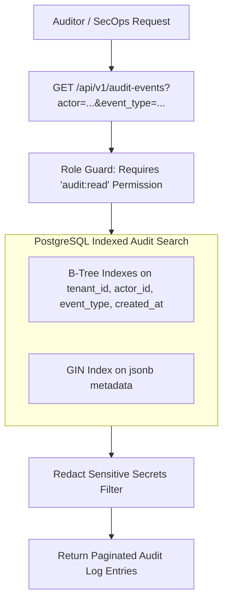

# P4-38 — Implement Advanced Audit Search and Filtering

**Parent Epic:** [Phase 4 — Enterprise Platform, Security & Scalability](../MILESTONE_PHASE_4.md)  
**Milestone:** [Phase 4 — Enterprise Platform, Security & Scalability](../MILESTONE_PHASE_4.md)  
**Workstream:** Workstream E — Governance, Scalability & Platform Controls  
**Status:** `ready-for-dev`  

---

## 🎯 Purpose

Extend Phase 1 and Phase 3 audit capabilities with enterprise-level search, filtering, and investigation support.

---

## 📐 Architecture & Workflow Diagram

---

## 📋 Detailed Requirements

- Define searchable audit event categories.
- Support filtering by: Actor, Organization and workspace, Event type, Resource reference, Time range, Outcome, Source identity or integration.
- Support pagination and stable sorting.
- Enforce role-based access to audit records (Auditor / Org Owner only).
- Redact sensitive metadata.
- Prevent ordinary users from altering audit records through search or export operations.
- Define indexing and query limits to prevent database resource exhaustion.
- Preserve correlation IDs to connect activity across services.

---

## 🛡️ Security & Architectural Invariants

- **Enterprise Multi-Tenancy:** Multi-organization and workspace hierarchy must never bypass or compromise the core tenant isolation boundaries established in ADR-0002.
- **Principle of Least Privilege:** RBAC/ABAC policy engines and service identity delegation must deny access by default and explicitly enforce permission scopes.
- **Tamper-Evident Auditability:** All administrative actions, SSO events, policy alterations, secret accesses, and integration invocations must emit structured, immutable audit log events.
- **Fail-Safe Operation:** Quotas, rate limits, distributed queue failovers, and webhook dispatchers must degrade gracefully without data loss, deadlocks, or silent failures.

---

## ✅ Acceptance Criteria

- [ ] Authorized auditors can search audit records.
- [ ] Filters and pagination work consistently.
- [ ] Tenant and organization isolation is enforced.
- [ ] Sensitive values are redacted.
- [ ] Query limits protect database resources.
- [ ] Audit search tests pass.

---

## 🔗 Related Documentation & Links

- Enterprise Architecture Baseline: [`docs/architecture/SYSTEM_ARCHITECTURE.md`](../../../docs/architecture/SYSTEM_ARCHITECTURE.md)
- Multi-Tenancy & Isolation Model: [`docs/architecture/TENANT_ISOLATION.md`](../../../docs/architecture/TENANT_ISOLATION.md)
- Security Policies & Auditing: [`docs/security/AUDIT_SPECIFICATION.md`](../../../docs/security/AUDIT_SPECIFICATION.md)
- API & Webhook Specifications: [`docs/api/API_SPECIFICATION.md`](../../../docs/api/API_SPECIFICATION.md)
