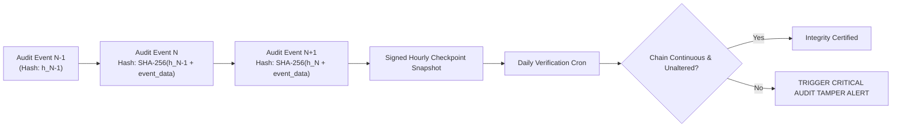

# P4-39 — Implement Tamper-Evident Audit Integrity Verification

**Parent Epic:** [Phase 4 — Enterprise Platform, Security & Scalability](../MILESTONE_PHASE_4.md)  
**Milestone:** [Phase 4 — Enterprise Platform, Security & Scalability](../MILESTONE_PHASE_4.md)  
**Workstream:** Workstream E — Governance, Scalability & Platform Controls  
**Status:** `ready-for-dev`  

---

## 🎯 Purpose

Strengthen audit integrity so unauthorized modification or deletion can be detected.

---

## 📐 Architecture & Workflow Diagram

---

## 📋 Detailed Requirements

- Review the existing append-only audit architecture.
- Implement a cryptographic hash chain: current_hash = SHA-256(previous_hash + event_data).
- Generate periodic signed checkpoints (Merkle tree root snapshots).
- Prevent ordinary application privileges from modifying integrity metadata.
- Define checkpoint frequency (hourly) and verification behavior.
- Detect missing, reordered, or altered records.
- Define alert and investigation handling for verification failures.
- Document the limitations of the selected tamper-evidence approach.
- Do not claim that cryptographic chaining alone prevents all privileged database tampering.

---

## 🛡️ Security & Architectural Invariants

- **Enterprise Multi-Tenancy:** Multi-organization and workspace hierarchy must never bypass or compromise the core tenant isolation boundaries established in ADR-0002.
- **Principle of Least Privilege:** RBAC/ABAC policy engines and service identity delegation must deny access by default and explicitly enforce permission scopes.
- **Tamper-Evident Auditability:** All administrative actions, SSO events, policy alterations, secret accesses, and integration invocations must emit structured, immutable audit log events.
- **Fail-Safe Operation:** Quotas, rate limits, distributed queue failovers, and webhook dispatchers must degrade gracefully without data loss, deadlocks, or silent failures.

---

## ✅ Acceptance Criteria

- [ ] An approved tamper-evidence design exists.
- [ ] Audit integrity verification is implemented.
- [ ] Alteration or deletion within the covered threat model is detectable.
- [ ] Verification failures are recorded and surfaced to authorized operators.
- [ ] Tests cover tampering, missing records, and verification failure.

---

## 🔗 Related Documentation & Links

- Enterprise Architecture Baseline: [`docs/architecture/SYSTEM_ARCHITECTURE.md`](../../../docs/architecture/SYSTEM_ARCHITECTURE.md)
- Multi-Tenancy & Isolation Model: [`docs/architecture/TENANT_ISOLATION.md`](../../../docs/architecture/TENANT_ISOLATION.md)
- Security Policies & Auditing: [`docs/security/AUDIT_SPECIFICATION.md`](../../../docs/security/AUDIT_SPECIFICATION.md)
- API & Webhook Specifications: [`docs/api/API_SPECIFICATION.md`](../../../docs/api/API_SPECIFICATION.md)
