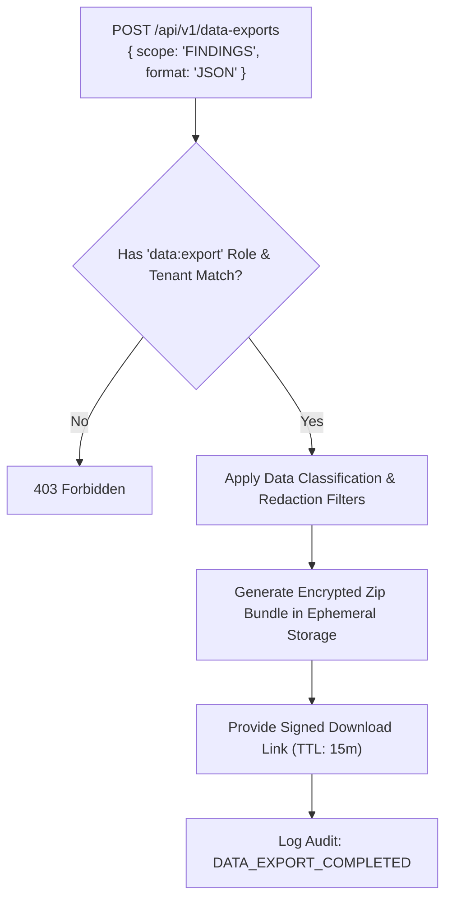

# P4-40 — Implement Enterprise Data Governance and Export Controls

**Parent Epic:** [Phase 4 — Enterprise Platform, Security & Scalability](../MILESTONE_PHASE_4.md)  
**Milestone:** [Phase 4 — Enterprise Platform, Security & Scalability](../MILESTONE_PHASE_4.md)  
**Workstream:** Workstream E — Governance, Scalability & Platform Controls  
**Status:** `ready-for-dev`  

---

## 🎯 Purpose

Provide organizations with controlled access to their data and the ability to export approved records without bypassing privacy or authorization requirements.

---

## 📐 Architecture & Workflow Diagram

---

## 📋 Detailed Requirements

- Define data classification categories (Public, Internal, Confidential, Restricted).
- Identify sensitive data across findings, evidence, reports, user profiles, and integration records.
- Define which roles may export each data category.
- Enforce authorization and tenant boundaries during exports.
- Support bounded exports for approved records (CSV, JSON, PDF).
- Apply redaction and evidence restrictions consistently.
- Define export format and schema versioning.
- Record export requester, scope, timestamp, and outcome.
- Prevent exports from bypassing retention, deletion, or access-revocation policies.
- Define safe handling of generated export artifacts.

---

## 🛡️ Security & Architectural Invariants

- **Enterprise Multi-Tenancy:** Multi-organization and workspace hierarchy must never bypass or compromise the core tenant isolation boundaries established in ADR-0002.
- **Principle of Least Privilege:** RBAC/ABAC policy engines and service identity delegation must deny access by default and explicitly enforce permission scopes.
- **Tamper-Evident Auditability:** All administrative actions, SSO events, policy alterations, secret accesses, and integration invocations must emit structured, immutable audit log events.
- **Fail-Safe Operation:** Quotas, rate limits, distributed queue failovers, and webhook dispatchers must degrade gracefully without data loss, deadlocks, or silent failures.

---

## ✅ Acceptance Criteria

- [ ] Data classifications are documented.
- [ ] Export permissions are enforced.
- [ ] Export contents respect redaction and retention requirements.
- [ ] Export artifacts are securely stored and accessed.
- [ ] Export activity is audited.
- [ ] Tests verify cross-tenant and unauthorized export prevention.

---

## 🔗 Related Documentation & Links

- Enterprise Architecture Baseline: [`docs/architecture/SYSTEM_ARCHITECTURE.md`](../../../docs/architecture/SYSTEM_ARCHITECTURE.md)
- Multi-Tenancy & Isolation Model: [`docs/architecture/TENANT_ISOLATION.md`](../../../docs/architecture/TENANT_ISOLATION.md)
- Security Policies & Auditing: [`docs/security/AUDIT_SPECIFICATION.md`](../../../docs/security/AUDIT_SPECIFICATION.md)
- API & Webhook Specifications: [`docs/api/API_SPECIFICATION.md`](../../../docs/api/API_SPECIFICATION.md)
